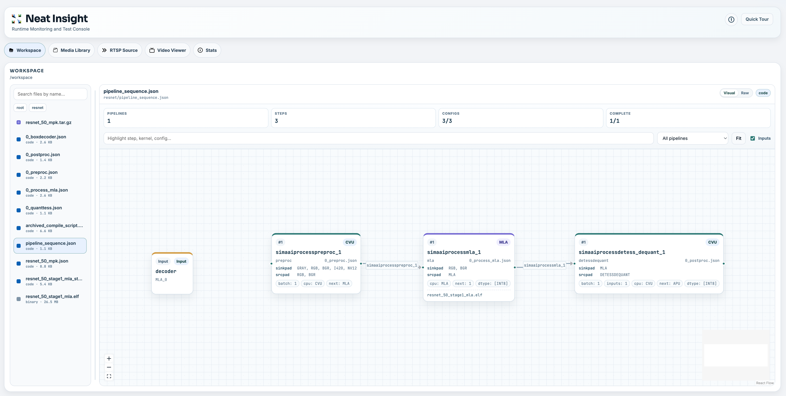
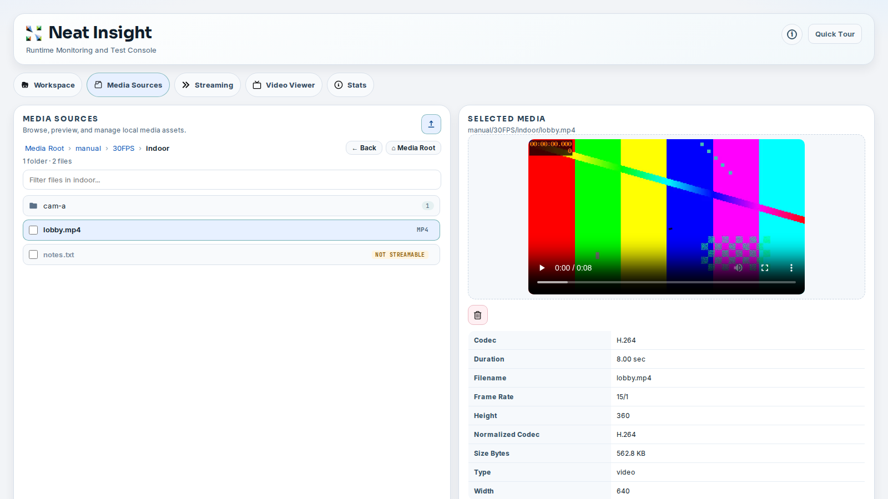
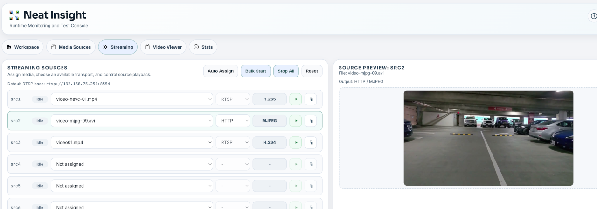
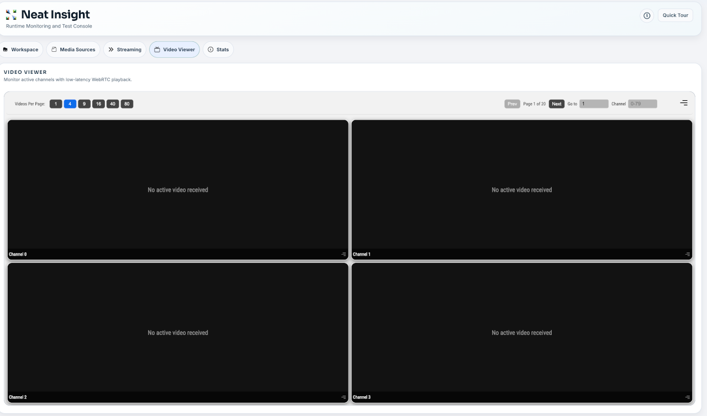

# ユーザーインターフェース

Insight は、ビジョンアプリケーションを検証する際に行う開発タスク、つまりファイルの確認、メディアの準備、ソースの起動、出力の表示、ランタイムの健全性の監視を中心に構成されています。

## ワークスペース

ワークスペース（Workspace）ビューでは、Insight から参照できるプロジェクトファイルを閲覧できます。Neat 開発環境では、通常これは `/workspace` です。SDK の外では、Insight は現在の作業ディレクトリにフォールバックします。

ワークスペースは次の用途に使用します:

- ソースファイル、設定、モデルのアーティファクト、生成された出力を検索・閲覧する。
- テキスト、コード、Markdown、画像、および一部のバイナリアーティファクトをプレビューする。
- MPK パッケージのアーカイブを、手動で展開せずに確認する。
- MLA の統計、MPK マニフェスト、パイプラインのシーケンスファイルなど、開発用の特殊なアーティファクトを表示する。

ワークスペースは、アプリケーションが複数のビルド出力やログを生成する場合に特に役立ちます。同じ開発セッションにとどまったまま、それらのアーティファクトをブラウザーから確認できます。



## メディアソース

メディアソース（Media Sources）は、アプリケーションのテストに使用するメディアファイルを追加・管理する場所です。**Import Media** を選択してインポートダイアログを開き、次の 3 つのソースから 1 つを選択します:

- **Local files**: コンピューターから 1 つ以上のファイルを選択するか、ドラッグ＆ドロップします。アップロードされた H.264 MP4 は、元のフレームレートを維持したまま、B フレームを無効にした低遅延再生向けの形式に正規化されます。
- **Catalog**: SiMa が厳選したビデオカタログからインポートし、既知のアセットで再現性のあるテストを行います。アセットの種類や名前で閲覧したり、カタログを検索したり、解像度、フレームレート、コーデックで絞り込んだり、ビデオをプレビューしたりしたうえで、1 つのバリアントをインポートするか、条件に一致する複数のアセットを選択してインポートします。
- **YouTube**: 通常の YouTube 動画の URL を貼り付け、検証してプレビューを表示し、開始時間、クリップの長さ、出力プロファイルを選択します。Insight は、`1080p30`、`720p30`、または `480p30` で 1 分、3 分、または 5 分のクリップをサポートします。インポートされたクリップは、B フレームを無効にした WebRTC 向けの H.264 に変換されます。配信中のライブストリームはサポートされていません。通常の動画、またはアーカイブされたライブストリームを使用してください。

カタログと YouTube からのインポートにはネットワークアクセスが必要です。Insight は、メディアのダウンロードと準備の間に進捗状況を表示し、結果をローカルのメディアライブラリに保存します。

サポートされているビデオ形式には、`mp4`、`mov`、`avi`、`mkv`、`webm` などの一般的なコンテナ形式が含まれます。Insight は、コーデックを考慮したストリーミングのために、MJPEG アセットと HEVC/H.265 メディアも認識します。MJPEG と HEVC のメディアは、元のコーデックの動作のままストリーミングできるよう、そのまま保持されます。

メディアをインポートした後は、ファイル一覧の絞り込み、選択したファイルのプレビュー、基本的なメタデータの確認、不要になったファイルの削除を行えます。ストリーミングソースを設定する前にメディアソースを使用して、どのファイルが利用可能か、Insight がどのコーデックを検出したか、ファイルが読み取り可能かを確認してください。



メディアソースは、インポート、ファイル選択、プレビュー、メタデータの確認、削除の操作を 1 つのビューにまとめています。インポートしたカタログアセットは `catalog/` 配下に、YouTube クリップは `youtube/` 配下に保存されるため、ファイルがどの経路でライブラリに追加されたかを識別できます。

## ストリーミングソース

ストリーミングソース（Streaming Sources）ビューは、アップロードされたメディアファイルをライブソーススロットに変換します。各ソーススロットは RTSP URL を公開できます:

```text
rtsp://127.0.0.1:8554/src1
rtsp://127.0.0.1:8554/src2
rtsp://127.0.0.1:8554/src3
```

これらの URL は、Insight と同じ SDK コンテナで実行されるアプリケーションで有効です。アプリケーションを DevKit または別の外部マシンで実行する場合は、SDK ホストの IP アドレスと、`neat --json` に示されるマッピング済みの `rtsp.tcp` ホストポートを使用してください。

Insight は、割り当てられたメディアに基づいてコーデックとトランスポートのオプションを選択します:

- H.264 メディアは、RTSP 経由で H.264 としてストリーミングされます。
- HEVC/H.265 メディアは、RTSP 経由で H.265 としてストリーミングされます。
- MJPEG メディアは、RTSP 経由で MJPEG として、または HTTP 経由で multipart MJPEG としてストリーミングできます。

コーデックは選択したメディアによって決まり、UI で手動で変更することはありません。RTSP 経由の MJPEG は RTP 互換の MJPEG にエンコードされ、HTTP MJPEG ではカメラ形式の HTTP テスト向けに MJPEG フレームをそのまま保持できます。

メディアのソースへの割り当て、個々のソースの開始と停止、ソーススロットへの重複しないファイルの自動割り当て、ソースの一括開始、全ストリームの停止、アプリケーションやテストハーネスで使用するストリーム URL のコピーを行えます。

このビューは、物体検出、セグメンテーション、トラッキング、分類、または GenAI ビジョンアプリケーション向けに、再現性のある入力ストリームが必要な場合に役立ちます。



ストリーミングソースビューでは、メディアファイルをソーススロットに割り当て、ストリームを開始または停止し、アクティブなストリームの URL をコピーし、アプリケーションに接続する前に選択したソースをプレビューできます。

### ウェブカメラをソースとして使用する

ブラウザーを実行しているコンピューターに接続されたウェブカメラを、ライブソースとして使用できます。そのため、最初にファイルをボードにコピーしなくても、実際のカメラでアプリケーションをテストできます。

1. メディアソースを開き、**Local cameras** の下にある **Enable camera access** を選択します。ブラウザーがカメラへのアクセス許可を求めます。Insight が代わりに許可することはできません。
2. アクセスを許可すると、各ソースのドロップダウンで、ビデオファイルの上にある **Cameras** グループにカメラが表示されます:

   ```text
   Not assigned
   Cameras
     Integrated Camera
     USB Camera
   Video files
     catalog/parking_garage_cars/parking_garage_cars_1080p.mp4
   ```

3. ソーススロットのカメラを選択し、**Start** を選択します。行には `[CAM]` バッジ（ビデオファイルの場合は `[VID]`）が表示され、ブラウザーがカメラを Insight に配信し、スロットは `Live` と表示されます。
4. **Copy URL** で RTSP URL を取得し、ファイルソースの場合とまったく同じように、アプリケーションでその URL を指定します。

カメラ一覧は、カメラの接続と切断に応じて更新されます。ウェブカメラソースは、映像のみを H.264 で配信します。

ソース一覧の横にあるプレビューには、キャプチャ中のローカルカメラの映像が表示されます。これはボードが受信した映像ではなく、受信側のアプリケーションで発生する遅延も表示されません。配信に失敗すると、キャプチャが停止し、プレビューは消去されます。

**Stop** を選択する、カメラを取り外す、またはブラウザーのタブを閉じると、ストリームが終了し、スロットは `Idle` に戻ります。**Stop All**、**Reset**、**Auto Assign** もすべてのウェブカメラを解放します。これらはいずれもスロットを取り上げる操作だからです。Reset と Auto Assign はカメラの選択も消去するため、後でカメラを選び直してください。ウェブカメラの配信中は、ブラウザーのタブを開いたままにする必要があります。映像を Insight に送信しているのはそのタブだからです。同じ理由で、Insight の再起動後にウェブカメラソースが `Live` の状態で復元されることはありません。カメラを選び直して、もう一度開始してください。

ウェブカメラの起動に失敗した場合は、メッセージに原因が示されます:

| 表示される内容 | 対処方法 |
| --- | --- |
| Camera permission was denied（カメラの許可が拒否されました） | ブラウザーの設定で Insight のサイトにカメラへのアクセスを許可し、メディアソース → Local cameras でカメラアクセスを再度有効にしてください。 |
| That camera is no longer available（そのカメラは利用できなくなりました） | カメラが切断されています。**Refresh cameras** を選択し、カメラを選び直してください。 |
| The camera could not be started（カメラを起動できませんでした） | 別のアプリケーションがカメラを使用しています。そのアプリケーションを閉じて再試行してください。 |
| Could not reach the webcam publish endpoint（ウェブカメラの配信エンドポイントに到達できませんでした） | ブラウザーが配信リスナーに到達できませんでした。`webrtcWhip` エンドポイントの証明書を信頼し（URL を一度開いて承認します）、ポートに到達できることを確認してください（[ポートとネットワークの動作](ports-network.md) を参照）。 |
| Webcam publish was rejected（ウェブカメラの配信が拒否されました） | Insight がストリームを受け入れられませんでした。`webrtcWhip` ポートに到達できること（[ポートとネットワークの動作](ports-network.md) を参照）と、ブラウザーが Insight の証明書を信頼していることを確認してください。 |

ブラウザーは、安全と見なしたページでのみカメラへのアクセスを許可します。**Enable camera access** を選択しても何も起こらない場合は、まず HTTPS で Insight を開き、その証明書を信頼してください。[インストールとアップグレード](install-upgrade.md) を参照してください。

## ビデオビューアー

ビデオビューアー（Video Viewer）は、ビデオフォワーダーからの低遅延の WebRTC ストリームを表示します。

チャンネル `N` の場合:

```text
video:    UDP 9000 + N
metadata: UDP 9100 + N
```

たとえば、チャンネル `0` はビデオに UDP `9000`、メタデータに UDP `9100` を使用し、チャンネル `1` はビデオに UDP `9001`、メタデータに UDP `9101` を使用します。

送信側が DevKit または別の外部マシンで実行されている場合は、`neat --json` に示されるマッピング済みの `videoUDP` と `metadataUDP` のホストポート範囲を使用してください。チャンネルの計算方法は同じですが、開始ポートが異なる場合があります。

ビューアーは、オブジェクト検出、分類、姿勢推定、セグメンテーション、トラッキングなど、一般的なビジョン出力のメタデータオーバーレイをレンダリングできます。メタデータタイプごとの **Show Overlay** スイッチで、信頼度しきい値やスタイルを変えずに出力を非表示にできます。姿勢推定では、関節マーカーとランドマーク名も個別に表示できます。フレームに関連付けられたデータは、チャンネルごとの補助パネルにも表示できます。組み込みの BlazePose 3D が最初のレンダラーです。複数の補助ビューはタブとして表示され、パネルは折りたたみ、拡大、非表示にできます。プロトコルについては [補助ビジュアライゼーション](auxiliary-visualizations.md) を参照してください。ビューアーの設定では、信頼度しきい値、ROI 表示、トラッキング履歴、同期バッファーなどを調整できます。ビデオフレームにあるタイプのメタデータがない場合（たとえば推論がビデオより遅い場合）、ビューアーはそのタイプの最後のオーバーレイを最大 200 ms 表示し続けます。同じタイプの新しいメッセージが届くと、オブジェクトを含まないメッセージであっても置き換えられます。メタデータのタイムスタンプはソースの PTS ミリ秒を使用し、利用できない場合は省略されます。

ビデオビューアーを使用して、次の点を確認します:

- アプリケーションは、指定されたチャンネルにビデオを送信しています。
- メタデータが、対応するメタデータチャンネルに送信されてきます。
- オーバーレイはビデオフレームに合わせて配置されます。
- 補助ビューは対応するビデオフレームとともにクリアおよび更新されます。
- ブラウザでの再生は正常です。



ビデオビューアーは一度に 1 つ以上のチャンネルを表示でき、大規模なマルチストリームテスト向けに、ページ送りとチャンネル選択のコントロールを備えています。

## ペリフェラル

ペリフェラル（Peripherals）ページには、ボードに接続されたカメラとマイクと、それぞれが報告する内容が一覧表示されます。これらはボード上の SiMa Sentinel が検出し、Insight は Sentinel のカタログを読み取ります。検出ではデバイス情報を読み取るだけで、デバイスを開いたりストリーミングしたりすることは決してないため、デバイスは引き続きアプリケーションから利用できます。デバイスを開くのはカメラのプレビューとマイクのテストだけで、それも実行している間だけです。

### 選択中のボード

Insight は、ヘッダーに表示される 1 台の選択中のボードを対象に動作します。これを選択するとボード設定が開き、ボードの変更、接続のテスト、再フラッシュされたボードのホストキーの信頼を行えます。ペリフェラルと統計はこの選択を使用します。

ボードは次の順序で選択されます:

- **入力したボード**: ボード設定を開き、アドレス、SSH ポート、ユーザーを指定します。**Use default** を選択すると、自動選択に戻ります。
- **ボードにインストールされた Insight**: Insight は、自身が実行されているボードを検査します。
- **Neat SDK**: `sima-cli sdk setup --devkit <ip>` でペアリングされた DevKit。

Insight は、自身を実行しているアカウントのキーを使用して SSH で接続します。パスワードを要求したり保存したりすることはありません。認証に失敗した場合は、ボード上でキーを承認するための `ssh-copy-id` コマンドがページに表示されます。ボードを再フラッシュすると、新しい SSH ホストキーが提示されます。フィンガープリントを比較して **Trust new key** を選択するまで、Insight は接続を拒否します。

### カメラとモード

**Refresh**（更新）を選択してボードをスキャンします。Insight は SiMa Sentinel に再スキャンを依頼し、結果を待ちます。Sentinel は、MIPI カメラをメディアグラフと ISP を通じて、USB カメラを V4L2 を通じて検出します。Sentinel がインストールされていない、実行されていない、またはペリフェラルを報告できないほど古い場合は、ページにその旨が表示されます。`sima-cli neat install sentinel` でインストールまたは更新してください。各カメラについて、ページには識別情報、接続、デバイス識別子、およびカメラが報告するピクセル形式と解像度が表示されます。どのカメラの解像度にもフレームレートは表示されません。MIPI カメラのレートは動作中のセンサーモードによって決まるため、カメラが動作するまでわからず、ページはすべてのカメラを同じように扱います。Insight はフレームレートを設定しません。各モードは次の 3 つの状態のいずれかで、ピクセル形式と解像度の各メニューの項目は、これらの状態ごとにまとめて表示されます:

| 状態 | 意味 |
| --- | --- |
| Available（利用可能） | ボードのカメラオーバーレイがカメラのセンサーをサポートし、ISP がそのモードのサイズを出力でき、かつピクセル形式が NV12 です。 |
| Unverified（未検証） | ISP が実行時にセンサーのサイズを取り込むボード（Platform 3.0）で、サポート対象センサーの NV12 サイズのうち、libcamera がそのサイズのままストリーミングすることを SiMa Sentinel が確認できないものです。libcamera がより大きいモードから切り出す可能性があるためです。確認のために選択してプレビューできますが、事前に選択されることはありません。 |
| Unsupported（サポート対象外） | 上記のいずれかの条件を満たしていません。USB カメラにはボード上のカメラオーバーレイがないため常に Unsupported（サポート対象外）となり、ページには理由が表示されません。MIPI カメラでは、どの条件かは表示される理由でわかります。センサーがボードのカメラオーバーレイに含まれていない、ISP がそのサイズを出力できない、形式が NV12 ではない、または ISP が実行時にセンサーのサイズを取り込むボード（Platform 3.0）で、サイズが libcamera のストリーミング幅（IMX477 では 4032 ピクセル）を超えている、のいずれかです。ボードのカメラオーバーレイを報告できないほど古い Sentinel では、更新するまですべてのモードが Unsupported（サポート対象外）のままになります。 |

各モードの状態は SiMa Sentinel が判定し、その理由も示します。Insight はその判定を表示します。判定を行えないほど古い Sentinel の場合、Insight は Sentinel のカタログに同じ規則を適用します。オーバーレイのチェックでは、ボードのデバイスツリーで Sentinel がカメラに関連付けたセンサーを、`/boot` 以下にインストールされたオーバーレイがサポートするセンサーと照合します。NV12 の条件は、Neat の `CameraInput` が NV12 を出力するという固定の事実に基づくもので、Insight がボード上の Neat に問い合わせることはありません。検出されたすべてのカメラには **Connected**（接続済み）のピルと状態が表示されます。いずれかのモードが Available（利用可能）であれば **Available**、そうでなくいずれかのモードが Unverified（未検証）であれば **Unverified**（未検証）、それ以外は **Unsupported**（サポート対象外）となり、Unverified または Unsupported のカメラではその理由がカメラのパネルに表示されます。Insight は、別のプログラムがカメラを使用中かどうかを示しません。

### カメラをプレビューする

**Start preview**（プレビューを開始）を選択すると、カメラが捉えている映像を確認できます。Insight は、既存の接続を介してボード上で GStreamer パイプラインを実行します。選択したモードをキャプチャし（MIPI カメラでは `libcamerasrc`、USB カメラでは `v4l2src`）、最大 15 fps、最大幅 640 ピクセルに縮小して JPEG フレームを送り返し、ページは届いたフレームを順に表示します。ボードには GStreamer 本体以外に何も必要ありません。`gst-launch-1.0` がない場合は、インストールすべきパッケージがプレビューに表示されます（`gstreamer1.0-tools`、`gstreamer1.0-plugins-base`、`gstreamer1.0-plugins-good`、および MIPI カメラ向けの `gstreamer1.0-libcamera`）。

プレビュー中はカメラが占有されるため、プレビューを停止するまでアプリケーションはカメラを開けません。Insight は、別のプロセスがすでに使用しているカメラではプレビューを開始せず、そのプロセスを代わりに停止することもありません。キャプチャは、**Stop**（停止）を選択したとき、ページを離れたとき、スキャンを更新したとき、または選択中のボードを変更したときに停止します。ブラウザを閉じた場合も停止します。Insight が停止または再起動した場合、ボードのパイプラインは、出力接続が閉じた後の次のフレームで終了します。ただし、通知のないままネットワークが切断された場合は、ボードの SSH 接続がタイムアウトするまでカメラを占有し続けることがあります。カメラを占有したままのプレビューを解除するには、ページにプレビューが表示されている間に **Stop**（停止）を選択するか、そのタイムアウトを待つか、ボード上の `gst-launch-1.0` プロセスを終了してください。

MIPI カメラでは、Available（利用可能）および Unverified（未検証）のモードをプレビューできます。ISP が実行時にセンサーのサイズを取り込むボード（Platform 3.0）では、センサーが列挙するサイズでも libcamera が出力しないことがあります。その場合、プレビューは libcamera がストリーミングするサイズを示すので、それを選択してください。USB カメラでは、MJPG または YUYV などの raw 形式で一覧表示される任意のモードをプレビューできます。これは、そのモードが Neat の `CameraInput` に対しては Unsupported（サポート対象外）であっても同様です。ボードに安定した `/dev/v4l/by-id` パスがある場合、Insight はそのパスでカメラを開きます。

プレビューの実行中は、その横のモードにカメラのフレームレートが表示されます。このレートはプレビューの 15 fps より速い場合があります。プレビューは、選択したモードのレートをカメラに要求します。USB カメラでは、表示されるのはそのモードのレートです。MIPI カメラでは、このモードでセンサーが出せる最大のレートが「up to」（最大）として表示されます。最初のフレームが届いた時点で Insight が SiMa Sentinel にこの値を問い合わせるため、レートは映像の数秒後に表示されます。Sentinel がレートを報告できない場合、レートは表示されません。

### Camera setup（カメラ構成）

ボードのデバイスツリーを読み取る Sentinel は、ボードのカメラ向けの構成も報告します。Refresh（更新）の後、ボード設定には、ボードの **Model**（モデル）と、ボードが読み込むオーバーレイのうちカメラセンサーを構成するものを示す **Camera setup**（カメラ構成）の行が表示されます。古い Sentinel では、これらの詳細は表示されません。

### マイク

Refresh（更新）では、SiMa Sentinel が報告するすべての ALSA キャプチャデバイス（USB またはオンボード）も一覧表示されます。各マイクについて、Insight は、名前、デバイスを開く際に使用する ALSA デバイス名（例: `hw:CARD=Nano,DEV=0`）、および USB オーディオデバイスの場合はキャプチャできるサンプル形式、チャンネル数、ビット深度、サンプルレートを表示します。オンボードのサウンドカードはこれらを報告しないため、ページにはその旨が表示されます。

検出でサウンドデバイスを開くことはありません。Sentinel は `/proc/asound` と sysfs を読み取ります。USB マイクは、取り外して同じポートに差し直した場合、カード番号が変わっても同じ識別情報を保ちます。別のポートに差した場合は、別のマイクとして扱われます。

マイクの音を確認するには、**Test microphone**（マイクをテスト）を選択して話します。レベルメーターに、マイクが拾っている音が表示されます。終わったら **Stop recording**（録音を停止）を選択すると（テストは 30 秒後に自動的に停止します）、Insight がページ内で録音を再生します。**Stop playing**（再生を停止）で再生を終了します。録音が約 -60 dBFS を下回ったままの場合は、何も拾われなかったことがページに表示されます。マイクのミュートボタンとゲインを確認してください。デバイスを開くのはテストだけであり、それも録音中に限られます。録音の前に、Insight は Sentinel のカタログを再度読み取り、Sentinel が示すデバイスからのみ録音します。前回のスキャン以降にボードのデバイスが変わっている場合は、先に更新するようページに表示されます。別のアプリケーションがマイクを開いている場合、テストは拒否され、そのアプリケーションには何も影響しません。Insight はオーディオ入力を設定しません。Core にはオーディオ入力がないためです。

## 統計

統計は、Sentinel（`simaai-sentinel` デーモン）からボード自身のテレメトリーを読み取るため、アプリケーションの動作とデバイスの動作を切り分けることができます。フレームドロップはストリーム経路に起因する場合もありますが、ボードの電力、ダイ上の温度、CPU 負荷、メモリ逼迫と相関している場合もあります。

統計は、ペリフェラルページと同じ **Board** パネルで選択したボードを対象に動作します。

### Sentinel デーモン

このページでは、まずそのボードに Sentinel がインストールされて実行中かどうかと、そのバージョンが表示されます。見つからない場合は、**Install Sentinel** を選択します。Insight はボード上で直接 `sima-cli neat install sentinel` を実行します。これには、ボード上の `sima-cli` とパスワードなしの `sudo` が必要です。どちらかが欠けている場合は、代わりにボード上のシェルで実行するコマンドがページに表示されます。インストール済みで実行中のデーモンが、ここから再インストールされることはありません。インストーラーがデーモンを再起動し、実行中のトレースが終了してしまうためです。

拒否された、または失敗したインストールは、読み取りの失敗ではなくインストールとして報告されます。ページには、インストールが行われなかったことと、その理由を示すボード自身のメッセージ（`sima-cli` がない、パスワードなしの `sudo` が使えない、インストーラーが 0 以外で終了した、またはインストーラーは完了したがサービスが停止したまま）が表示され、インストーラーの出力は **Installer output** の下に保持されます。

### ライブメトリクス

DevKit ビューは、Sentinel 自身のターミナルダッシュボード（`simaai-sentinel ops`）と同様のレイアウトになっています。ステータス行には、読み取り値がライブかどうかと、現在の Sentinel セッションの開始時刻が表示されます。セッションの平均とピークは、このセッションを対象とします。**Export CSV** は、Sentinel がそのセッションについて保持している各サンプル時点のすべてのメトリクスをダウンロードします（最後の 240 件で約 8 分間。より長い期間が必要な場合は **Runs** でトレースを記録します）。**Pause updates** はポーリングを停止します。その下には 6 つのタブがあります:

- **Overview**（概要）: 最も高温の温度センサー、ボードの電力、CPU 使用率、Linux メモリ、MLA メモリ、ネットワークトラフィックのグラフ。その下には **All metrics** が折りたたまれており、すべてのメトリクスが Sentinel の順序で表示されます。
- **Thermal**（温度）: 最も高温のセンサーの時系列と、各センサーグループ（MLA、APU、CVU、TOP、Board）の小さなグラフ。
- **Power**（電力）: 現在、セッション平均、セッションピークの電力の数値、セッション平均を示したウィンドウ全体のボード電力、および上端がボード合計になるように積み上げた電源レール。
- **System**（システム）: **CPU & memory** は、CPU 使用率、ロードアベレージ、Linux メモリ、MLA メモリ、EV74 メモリをグラフ表示します。**Per-core CPU** は負荷のヒートマップで、コアごとに 1 行、ウィンドウの 10 秒ごとに 1 列を単一の青色で表示し、各コアの 1 分平均と最も負荷の高いコアを示します。平均がコアの制限値を超えると、琥珀色または赤色になります。
- **Storage & Network**（ストレージとネットワーク）: eMMC の使用量、ネットワークの受信と送信、eMMC の読み取りと書き込み、およびそれらのメトリクス。
- **Runs**（実行）: トレースを記録し、保存済みの実行を開く、比較する、または削除します。比較では、選択したすべての実行について、それらすべてに共通する期間にわたり、1 つの系列（総電力、温度の最大値、CPU、負荷、RAM、MLA メモリ、または EV74 メモリ）を、実行に合わせたスケールで重ねて表示します。各実行の最小値、平均値、中央値、P95、最大値、ベースラインに対する変化、エネルギーも表示されます。メトリクスごとの比較はその下に折りたたまれています。

グラフは固定のスケール（割合は 0-100、温度は 40-90 °C、それ以外はピークを上回るきりのよい数値まで）を使用し、Sentinel が定義する警告レベルと危険レベルを示し、ホバーした時点のすべての系列の値を表示します。色はステータスを表します。グラフは、読み取り値が警告レベルまたは危険レベルを超えるまでは青色で、超えると琥珀色または赤色になります。タブ内のメトリクスがしきい値を超えると、そのタブ名にマークが付きます。ボードが測定できないメトリクスは、ゼロではなく em ダッシュで表示されます。

グラフは、Sentinel が保持するウィンドウ全体である 240 サンプル（約 8 分間）を表示します。ボードを最初に読み取るときと、ポーリングが 1 分以上止まった後には、Insight が Sentinel 自身のキャッシュからサンプルを取得し、その後は、タブが開いて表示されている間、2 秒ごとにサンプルを追加します。ブラウザーのタブが非表示になったときや、ビューを離れたときにも、ポーリングは停止します。

閲覧中にボードが応答しなくなった場合、ポーリングは停止しますが、ページを空にするのではなく、パネルはそのまま残り、最後に読み取った値と、何が失敗したかについてのボード自身の説明を表示し続けます。別のボードを選択した場合はこれとは異なります。その場合はまずすべてがクリアされるため、あるボードの数値が別のボードの名前の下に表示されることはありません。

### トレースと実行

トレースは、ワークロードの前後のすべてのサンプルを記録します。名前を付け、必要に応じてメモとタグを追加して、**Start trace** を選択します。**Stop trace** を選択すると、トレースが実行（run）としてボードに保存されます。Sentinel が記録できるトレースは一度に 1 つだけで、保存済みの実行ですでに使われている名前は拒否されます。保存済みの実行は、状態、開始時刻、期間、その実行で Sentinel が測定したエネルギー、サンプル数とともに一覧表示され、デーモンを再起動しても保持されます。実行を開くと、その要約が表示されます。記録されたすべてのメトリクスが、当時有効だったラベル、単位、グループ、しきい値とともに、その実行のサンプルにおける最小値、最大値、平均値とあわせて表示されます。実行中のいずれかの時点で警告または危険のしきい値を超えたメトリクスにはマークが付きます。サンプルを 1 つしか取得できなかった実行は、その時点から同じ時点までの範囲としてではなく、取得された瞬間として報告され、その平均値、最小値、最大値は、すべて等しい単一の値として示されます。実行のメタデータ（名前、メモ、サンプル間隔、Sentinel のバージョン、実行されたボード）は、その下に表示されます。

実行にチェックを付けると、選択されている数と、それらに対して実行できる操作を示すツールバーが表示されます。2 つから 8 つを選択して **Compare** を選ぶと、メトリクスが行、実行が列に並びます。Sentinel は 1 つのベースラインの実行に対して比較を行います。ベースラインは、各実行のメモとともにヘッダーにマークされます。それ以外の各セルには、その実行におけるそのメトリクスの平均値と、その横にベースラインに対する変化率が表示されます。表示できないほど小さな変化は、変化なしとしてではなく「<0.01%」と表示されます。

セルに変化の代わりに「—」が表示されている場合、Sentinel は変化を示していません。表は、1 つの em ダッシュですべての理由を表すのではなく、どの理由に該当するかを示します。「—」にホバーするか、Tab キーで移動するか、タップすると、その横に理由が表示されます。スクリーンリーダーは、ダッシュとともに理由を読み上げます。理由は次のとおりです:

- **Sentinel publishes no change for it.**（Sentinel がこの項目の変化を公開していない）実行の合計値（期間、エネルギー、サンプル数）は、割合なしで実行ごとに報告されます。
- **The baseline measured 0, and there is no percentage change from 0.**（ベースラインの測定値が 0 であり、0 からの変化率は存在しない）ベースラインではそのメトリクスを測定していますが、0 からの割合が存在しないだけです。これはアイドル状態のベースラインにおけるコアごとの CPU 使用率でよく見られ、変化が最も大きくなりやすい箇所でもあります。ベースラインで平均 0%、もう一方の実行で 5.9% だったコアはここで「—」と表示されるため、変化ではなく 2 つの値を読んでください。
- **The baseline run has no value for that metric.**（ベースラインの実行にそのメトリクスの値がない）ベースラインがそのメトリクスをまったく測定していない唯一のケースです。
- **This run has no value for that metric.**（この実行にそのメトリクスの値がない）実行が一覧に表示されているものの、Sentinel がその実行について何も要約しなかった場合は、列全体がこの表示になり、表の上でその旨が示されます。

実行の合計値は、ビューの他の部分と同じ単位で表示されます。Sentinel がミリ秒で報告する期間は秒で、エネルギーはジュールで表示されます。

選択中の実行がボード上で削除されると、その行は一覧から消え、選択を解除するためのチェックボックスもなくなるため、すべての比較がその実行で失敗します。Insight は、Sentinel が一覧に含めなくなった選択中の実行の名前を示し、選択から外すことを提案します。

実行を開く操作と比較する操作には、サイズの上限があります。Insight がボードから読み取る Sentinel の応答は最大 12 MiB で、保存された実行には、記録されたすべてのサンプル（2 秒ごとに 1 つ）が含まれます。約 3 時間を超える実行は開くことができず、長さの合計が約 3 時間を超える複数の実行は一緒に比較できません。その場合、Insight は応答が大きすぎて読み取れなかったことを示します。開いたり比較したりする予定の実行は、短めのトレースとして記録してください。

比較では実行をカンマ区切りの名前のリストとして要求するため、トレース名にカンマを含めることはできません。含めると、要求はボードに存在しない 2 つの実行として解釈され、誰も選択していない実行の名前を挙げて失敗します。Insight は、トレースの開始時にそのような名前を拒否し、すでに保存されている実行にそのような名前がある場合は、Compare（比較）をその実行で失敗させるのではなく、その名前を示します。

### 離れたボードからの値

ボードの読み取りには SSH の往復が必要なため、別のボードを選択した後に応答が届くことがあります。別のボードを選択すると、前のボードから届く途中のものはすべてキャンセルされます。新しいボードはすぐに確認され、古いボードからの遅れた応答は、新しいボードの値として表示されるのではなく破棄されます。**Stop trace** は、トレースを読み取ったボードの名前を示し、別のボード上のトレースを停止する代わりに拒否されます。選択中のボードが別の場所（別のブラウザータブや API クライアント）で変更された場合、ページにすでに表示されている値には取得元のボードのラベルが付き、再度読み取る手段が提供されます。

### Insight ホスト

実行の下にあるコンパクトなパネルには、`/api/metrics` から取得した、Insight 自体が実行されているマシン（SDK コンテナ、または Insight がインストールされているボード）の情報として、CPU 負荷、メモリ、ディスク、およびプラットフォームが公開している場合は温度が表示されます。これは、上にあるボードのテレメトリーとは別の問い（たとえば、コンテナのディスクが不足していないか）に答えるもので、2 秒ごとではなく 15 秒ごとに読み取られます。従来の `REMOTE_DEVKIT` 設定が有効な場合、このパネルは代わりにその接続について報告し、その旨を表示します。エンドポイントが読み取り値をまったく返さない場合、パネルはラベルを em ダッシュとともに並べるのではなく、その旨を表示します。

### NEAT プロファイリングタイムライン

タブの最後にあるプロファイリングタイムラインは、実行中のアプリケーションから Insight がストリーミングするプロファイリングイベントの数値フィールドをプロットします。これは Sentinel から独立しており、デバイスではなくアプリケーションを測定します。

## GenAI Studio

GenAI Studio ビューでは、ボード上で言語、視覚、音声モデルを実行できます。ボード上でバックエンド専用モードで動作する Neat Apps の GenAI Studio と通信します。Insight がすべての呼び出しを中継するため、ブラウザーがボードに直接接続することはありません。

GenAI Studio はボード上で動作します。以下のとおりタブからインストール、準備、起動ができます。ボードのシェルから起動する場合は、GenAI Studio アプリケーションディレクトリで次を実行します。

```bash
./run.sh
```

初回は、ボードに GenAI Studio をインストールする必要があります。タブが GenAI Studio に接続できない間は、**Tutorial** が初めての利用かどうかを尋ね、バナーのボタンからも同じパネルを開けます。ボタンは **Set up GenAI Studio**、またはインストール済みの場合は 1 回のクリックで起動する **Start GenAI Studio** です。パネルは、Insight が接続しているボードで Apps をインストールし（`NEAT_APPS_SKIP_DEPENDENCIES=1 sima-cli neat install apps`。インストール済みの Core と Insight はそのまま）、`setup.sh` で GenAI Studio を一度だけ準備し（ボードのインターネット接続が必要、約 15 分）、`./run.sh` で起動します。各手順は、完了するとチェックマーク、実行中は回転するアイコン、順番が来るまでは灰色の円で表示されます。各手順はボード上で 1 つのジョブとして実行され、ページを閉じても続行します。ログは `~/.neat-insight/genai-setup/` にあります。失敗した手順には、原因、対処方法、最後の出力が、**Retry** と手動で実行するコマンドとともに表示されます。警告付きで完了した手順は警告と対処方法を一覧表示し、セットアップの警告を解決した後に **Run setup again** を押すと、`setup.sh` を再実行して GenAI Studio を再起動します。数分間新しい出力がない手順はその旨を表示し、**Stop** で停止できます。

初回アクセス時は、ページ上部に各機能を紹介する短い **Tutorial** が開きます。ヘッダーの **Tutorial** でいつでも再表示できます。ヘッダーには状態ラベル、**Model** セレクターとその隣の **New chat**（鉛筆）、**Read replies aloud**、**Think first**（常に直接回答するモデルでは無効）、**Use my documents** があります。ツールバーには **Export chat**、**SiMaSentry Solutions**（盾）、**Benchmark**（計器）、**Tutorial**、**Settings**、**Full screen** があります。

状態ラベルと、対応が必要なときに表示されるバナーで、バックエンドの状態と次の操作を確認できます。

- **Not set up**: ボードが選択されておらず、設定が開きます。`https://192.168.1.20:5000` などのボードのアドレスを入力します。ボード上の Insight はローカルのバックエンドを、Neat Development Environment ではペアリング済みの DevKit を既定で使用します。
- **Not running**: ボードが応答しません。バナーの **Start GenAI Studio** で起動するか（初回は **Set up GenAI Studio**）、アドレスを確認します。
- **Error**: ボードがエラーを返したか、アドレスが GenAI Studio を指していません。バナーにボードのメッセージが表示されます。
- **Starting**: バックエンドは応答していますが、モデルサーバーの準備ができていません。
- **Busy**: モデルの読み込み中です。チャットと音声は完了するまで待機します。
- **Incompatible**: ボードの GenAI Studio API バージョンがこの Insight と一致しません。バナーに示された方を更新します。
- **Ready**: チャットと音声を使用できます。ボードで音声の読み込みに失敗した場合も、ここに表示されます。

**No model yet**: ボードにチャットモデルや視覚モデルがない場合（または実行できないモデルしかない場合）、メッセージ欄をグレーアウトしたままにせず、チャットにその旨を表示します。**Download Qwen3 VL 4B** は視覚言語モデル `simaai/Qwen3-VL-4B-Instruct-Autoround-a16w4` をボードにダウンロードし、ボタンの下に進捗を表示してから読み込みます。ボードがダウンロードサイズを調べると、ボタンにそのサイズが表示され、ボードの空き容量がそれより少ない場合は警告します。**Browse models** は **Settings** の **Models** で Hugging Face 検索を開き、ボードがダウンロードできるモデルを一覧表示します。ボードがダウンロードを許可していない場合は、ボード上の GenAI Studio の `config.local.yaml` で `server.hub.allow_download: true` を設定して GenAI Studio を再起動するようチャットに表示されます。ボードが Hugging Face に接続できない場合はその旨を表示し、**Check again** で再確認します。Hugging Face でモデル名が変更されている場合は、失敗したダウンロードに新しい ID が表示され、代わりにそのモデルをダウンロードするよう提案します。

**Chat** はページ中央の会話です。メッセージ欄に入力するか、マイクを押して話し、もう一度押すと、発話が文字起こしされて送信されます。画像を扱えるモデルでは、画像の添付、このブラウザーのカメラでの撮影、ボードに接続したカメラでの撮影ができます。ビデオカメラボタンにはボードのカメラ（`/dev/videoN`）が一覧表示され、**Take a picture** でボードの写真を次のメッセージに添付します。ボードカメラには `board_camera` 機能を報告する GenAI Studio が必要です。古いバージョンではボタンが非表示になり、カメラボタンのツールチップに理由が表示されます。回答は生成とともに表示され、停止ボタンで途中終了できます。**New chat** で最初からやり直すと、モデルは会話を忘れます。**Read aloud** は回答を1つ読み上げ、**Stop speaking** は読み上げを停止します。**Read replies aloud** はすべての回答を読み上げ、残りの生成中に最初の文から再生します。初回はブラウザーがマイクとカメラの使用許可を求めます。

各回答の下に、Insight がブラウザーで測定した生成速度を表示します。

- **First token**: 送信から回答の最初のテキストまでの時間。
- **Speed** と **Tokens**: 1秒あたりのトークン数と回答の長さ。速度はボードが報告すればその値を使い、それ以外は Insight がブラウザーで計算します。
- **Total**: 送信から回答の終了までの時間。
- **First audio**、**RTF**、**Voice**（回答の読み上げ時）: 再生開始までの時間、リアルタイム係数（音声1秒あたりの計算秒数。1未満はリアルタイムより高速）、音声エンジン。
- **Transcribed** と **Language**（音声で質問した場合）: 録音終了からテキストになるまでの時間と認識した言語。

**Vision**（メッセージ欄の下の目のアイコン）は、単体版 GenAI Studio の全画面視覚機能と同様に、カメラ映像を収まる範囲で最大（画面の高さの半分まで）に表示し、その下に最新の回答と操作ボタンを表示します。**This browser's camera** または **Board camera** を選びます（ボードは質問ごとに新しい写真を撮り、**Take a picture** で構図を確認できます）。質問を入力するか、**What do you see?**、**Describe the scene in detail**、**Read any text in view** を選び、次の操作を行います。

- **Ask** は現在の写真について1回質問します。
- **Loop** は回答のたびに新しい写真について同じ質問を繰り返します。リクエストは1回ずつ送られ、回答間に短い間隔を置き、**Stop** を押すまで続きます。ループ中に質問を編集すると次の写真から適用されます。**Read answers aloud** が有効なら、回答を読み上げてから次の写真を撮ります。

モデルが変更された、画像を扱えなくなった、ボードが応答しなくなった、別の操作を開始した、写真や回答の取得に失敗した（理由が表示されます）、ボードのアドレスが変わった、ビューを閉じた、タブを離れた場合もループは停止します。Vision の質問はチャット履歴を含まない独立したリクエストで、回答はチャットに追加されません。ビューの **Full screen** は画面全体を使い、Esc または **Close** でチャットに戻ります。

**Export chat** は会話を `.log` テキストファイル（`neat-chat-<date>-<time>.log`）に保存します。先頭にエクスポート時刻とモデル、その後に各発言が記録され、画像は `[image]` と表示されます。

**SiMaSentry Solutions** は、読み込み済みのチャットモデルを Insight 経由で使う3つのデモアプリを開きます。**SiMaSentry-Med**（臨床チャットと医用画像の確認）、**SiMaSentry-Safe**（PPE と危険の確認）、**SiMaSentry-Sec**（監視映像の分析と変化検出）です。画像機能には画像を扱えるモデルが必要です。モデルはボード上で動作しますが、これらのアプリの音声入力はブラウザーの音声認識を使うため、音声がオンラインサービスに送信される場合があります（Chrome は送信します）。アプリ内の Home ボタン、**Back**、Esc でランチャーに戻り、**Close** でチャットに戻ります。

**Benchmark** はボードのチャットモデルを測定します。モデルを1つ以上、実行回数（1～50）、回答のトークン数（8～2048）、必要に応じてプロンプトを選び、**Run benchmark** を押します。モデルは順番に実行され、未読み込みのモデルは最初に読み込まれます。この際にチャットモデルがアンロードされることがあるため、終了後に **Model** メニューから再度読み込みます。実行中は進捗と回答が表示され、**Stop** で終了します。結果では1秒あたりのトークン数（平均、p90、標準偏差）、最初のトークンまでの時間、回答の長さを比較し、最速の値を強調表示します。**Each run** は最後のモデルの各実行を表示します。**Download CSV** と **Download JSON** で結果を保存します。

**Use my documents** はボード上の文書データベースを使って回答します。ボードが質問に合う文章を検索し、モデルが回答する前に追加します。回答の下には使用したセクション名（または一致なし）が表示されます。**Settings** の **Documents** では、データベースの内容確認、Markdown ファイルのアップロード（既存文書を置換）、既定の SiMa 文書へのリセット、消去ができます。**View documents** は取り込んだソースファイル、セクション（チャンク）数、各セクションの見出しパスと本文を一覧表示します。**Filter sections…** で文章を検索できます（最初の2,000セクションまで）。文書機能には文書検索に対応した GenAI Studio が必要です。非対応ならスイッチが無効になり、理由が表示されます。

**Settings** には領域ごとに1枚のカードがあります: **Board**、**Replies**、**Models**、**Voice**、**Documents**、**Troubleshooting**。各カードのタイトルには、現在の設定を1行でまとめた要約が表示されます（例: `192.168.1.20:5000 · Ready`、`Default system prompt · longest reply 512 tokens`、`Qwen3 VL 4B loaded · 3 models on the board`）。

- **Board**: ボードのアドレス。
- **Replies**: **System prompt** は、すべてのチャットと Vision の質問とともに送信される指示です。変更するまで、欄には既定値が表示されます: "You are a helpful assistant. Answer clearly and concisely. Use Markdown formatting when it helps. Answer the question in the language it was asked in." 編集すると既定値が置き換わります。**Reset to default** で既定値に戻り、欄を空のままにすると既定値が送信されます（空のプロンプトは送信されません）。小型の視覚モデルが誤判断しないよう、タブはメッセージに画像があるかどうかを示す1文を引き続き追加します。**Longest reply** は回答の最大トークン数を設定します（32～2048、既定512。単体版 GenAI Studio と同じ）。`max_tokens` として送信され、独自の設定を持つベンチマークには影響しません。このブラウザーは両方の設定を記憶します。
- **Models**: 空きディスク容量に続き、ボード上の各モデルを1行ずつ、種類（**Chat**、**Vision**、**Speech**）、サイズ、状態（**Loaded**、音声モデルの **In use**、**Loading…**、**Not loaded**、**Can't run here**。理由はツールチップに表示）とともに表示します。**Load**、**Unload**、**Use** で使用中のモデルを変更し、バナーに読み込みの進捗を表示します。**Delete** は確認後にダウンロード済みモデルのファイルをボードから削除します。読み込まれておらず、使用中の音声モデルでもないモデルだけが対象です。拒否された場合はボードの理由を表示します。**Get more models** は Hugging Face を検索し、**Download** でモデルをボードに置きます。ダウンロードを許可していないボードでは、許可する方法を表示します。
- **Voice**: 音声エンジン、声、話す言語。
- **Documents**: 上記の **Use my documents** を参照してください。

モデルの読み込みに失敗したり回答が止まったりした場合は、ボード上の GenAI Studio を再起動します（`./run.sh stop`、続けて `./run.sh`）。アクセラレーターが解放され、モデルを再度読み込めます。**Settings** の **Troubleshooting** にもこの手順があります。

## システム情報

システム情報パネルには、Insight から見える環境の概要が表示されます。Neat 開発環境では、SDK とコンポーネントの情報、Insight のステータス、更新情報、`mainUI` や `videoUI` などの公開ポートのマッピングを表示できます。

URL がデフォルトのポートと一致しない場合は、まずここを確認してください。Insight は利用可能なポートマップを読み取り、ビューアーを開くときにマッピングされた `videoUI` ポートを使用します。コマンドラインのワークフローでは、`neat --json` に同じポートマップの情報が表示されます。
