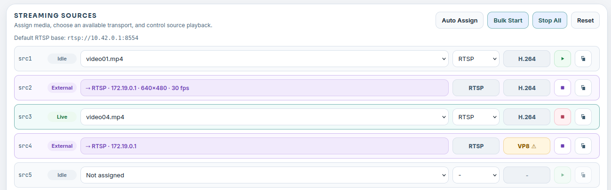

# Інтерфейс користувача

Insight організовано навколо завдань розробки, які ви виконуєте під час перевірки застосунку комп’ютерного зору: перегляд файлів, підготовка медіа, запуск джерел, перегляд результатів і стеження за станом середовища виконання.

## Робочий простір

Подання «Робочий простір» (Workspace) дає змогу переглядати файли проєкту, видимі для Insight. У середовищі розробки Neat це зазвичай `/workspace`; поза SDK Insight використовує поточний робочий каталог.

Використовуйте робочий простір, щоб:

- Шукати й переглядати вихідні файли, конфігурацію, артефакти моделей і згенеровані результати.
- Попередньо переглядати текст, код, Markdown, зображення та вибрані двійкові артефакти.
- Переглядати архіви пакетів MPK без ручного розпакування.
- Переглядати спеціалізовані артефакти розробки, як-от статистику MLA, маніфести MPK і файли послідовностей конвеєра.

Робочий простір особливо корисний, коли застосунок створює кілька результатів збірки та журналів. Він дає змогу переглядати ці артефакти в браузері, не виходячи з поточного сеансу розробки.


## Джерела медіа

У поданні «Джерела медіа» (Media Sources) ви додаєте медіафайли для тестування застосунків і керуєте ними. Виберіть **Import Media**, щоб відкрити діалогове вікно імпорту, а потім виберіть одне з трьох джерел:

- **Local files**: виберіть або перетягніть один чи кілька файлів зі свого комп’ютера. Завантажені файли H.264 MP4 нормалізуються для відтворення з низькою затримкою: B-кадри вимикаються, а частота кадрів джерела зберігається.
- **Catalog**: імпортуйте відео з добірного відеокаталогу SiMa для повторюваних тестів на відомих ресурсах. Переглядайте ресурси за типом або назвою, шукайте в каталозі, фільтруйте за роздільною здатністю, частотою кадрів і кодеком, переглядайте відео, а потім імпортуйте один варіант або виберіть та імпортуйте кілька відповідних ресурсів.
- **YouTube**: вставте URL звичайного відео YouTube, перевірте його, щоб побачити попередній перегляд, і виберіть час початку, тривалість кліпу та профіль виводу. Insight підтримує кліпи тривалістю 1, 3 або 5 хвилин у форматах `1080p30`, `720p30` або `480p30`. Імпортований кліп перетворюється на H.264, зручний для WebRTC, із вимкненими B-кадрами. Активні прямі трансляції не підтримуються; використовуйте звичайне відео або архівний запис прямої трансляції.

Імпорт із каталогу та YouTube потребує доступу до мережі. Insight показує перебіг, поки завантажує й готує медіа, а потім зберігає результат у локальній медіатеці.

Підтримувані відеоформати включають поширені контейнерні формати, як-от `mp4`, `mov`, `avi`, `mkv` і `webm`. Insight також розпізнає ресурси MJPEG і медіа HEVC/H.265 для потокової передачі з урахуванням кодека. Медіа MJPEG і HEVC зберігаються без змін, щоб їх можна було передавати потоком з початковою поведінкою кодека.

Після імпорту медіа ви можете фільтрувати список файлів, попередньо переглядати вибраний файл, переглядати його основні метадані або видаляти файли, які більше не потрібні. Використовуйте «Джерела медіа» перед налаштуванням потокових джерел, щоб знати, які файли доступні, який кодек виявив Insight і чи файли читаються.


«Джерела медіа» поєднують в одному поданні імпорт, вибір файлів, попередній перегляд, перегляд метаданих і видалення. Імпортовані ресурси каталогу зберігаються в `catalog/`, а кліпи YouTube — у `youtube/`, тож ви можете визначити, як файли потрапили до медіатеки.

## Потокові джерела

Подання «Потокові джерела» (Streaming Sources) перетворює завантажені медіафайли на слоти живих джерел. Кожен слот джерела може надавати URL RTSP:

```text
rtsp://127.0.0.1:8554/src1
rtsp://127.0.0.1:8554/src2
rtsp://127.0.0.1:8554/src3
```

Ці URL правильні для застосунків, що працюють у тому самому контейнері SDK, що й Insight. Якщо застосунок працює на DevKit або іншій зовнішній машині, використовуйте IP-адресу хоста SDK і зіставлений порт хоста `rtsp.tcp` з `neat --json`.

Insight вибирає параметри кодека та транспорту залежно від призначеного медіа:

- Медіа H.264 передається потоком через RTSP як H.264.
- Медіа HEVC/H.265 передається потоком через RTSP як H.265.
- Медіа MJPEG може передаватися потоком через RTSP як MJPEG або через HTTP як multipart MJPEG.

Кодек визначається вибраним медіа й не змінюється вручну в інтерфейсі. MJPEG через RTSP кодується в MJPEG, сумісний з RTP, тоді як HTTP MJPEG може зберігати кадри MJPEG для тестування HTTP у стилі камери.

Ви можете призначати медіа джерелу, запускати й зупиняти окремі джерела, автоматично призначати унікальні файли слотам джерел, масово запускати джерела, зупиняти всі потоки та копіювати URL потоків для використання застосунками або тестовими оснастками.

Це подання корисне, коли вам потрібні повторювані вхідні потоки для застосунку комп’ютерного зору з виявленням об’єктів, сегментацією, відстеженням, класифікацією або GenAI.


Подання «Потокові джерела» дає змогу призначати медіафайли слотам джерел, запускати або зупиняти потоки, копіювати URL активного потоку та попередньо переглядати вибране джерело, перш ніж під’єднати його до застосунку.

### Використання вебкамери як джерела

Вебкамеру, під’єднану до комп’ютера, на якому працює ваш браузер, можна використовувати як живе джерело, щоб тестувати застосунок зі справжньою камерою без попереднього копіювання файлу на плату.

1. Перейдіть до «Джерел медіа» і в розділі **Local cameras** виберіть **Enable camera access**. Браузер запитає дозвіл на доступ до камери; Insight не може надати його замість вас.
2. Після того як ви дозволите доступ, ваші камери з’являться в кожному розкривному списку джерел у групі **Cameras**, над відеофайлами:

   ```text
   Not assigned
   Cameras
     Integrated Camera
     USB Camera
   Video files
     catalog/parking_garage_cars/parking_garage_cars_1080p.mp4
   ```

3. Виберіть камеру для слота джерела, а потім виберіть **Start**. Рядок показує позначку `[CAM]` (відеофайли показують `[VID]`), браузер публікує камеру в Insight, а слот повідомляє `Live`.
4. Скористайтеся **Copy URL**, щоб отримати URL RTSP, і спрямуйте на нього свій застосунок так само, як для файлового джерела.

Список камер оновлюється, коли камери під’єднуються та від’єднуються. Джерела вебкамер публікують лише відео у форматі H.264.

Попередній перегляд біля списку джерел показує зображення з вашої локальної камери, поки триває захоплення. Це не те відео, яке отримала плата, і воно не показує затримки, яку бачить застосунок-приймач; якщо публікація не вдається, захоплення зупиняється, а попередній перегляд очищується.

Вибір **Stop**, від’єднання камери або закриття вкладки браузера завершує потік і повертає слот у стан `Idle`. **Stop All**, **Reset** і **Auto Assign** також звільняють усі вебкамери, оскільки кожна з цих дій забирає ці слоти: Reset і Auto Assign також очищують вибір камери, тож потім виберіть камеру знову. Вкладка браузера має залишатися відкритою, поки вебкамера публікує відео: саме вона надсилає відео до Insight. З тієї самої причини джерело вебкамери ніколи не відновлюється як `Live` після перезапуску Insight — виберіть камеру повторно й запустіть її знову.

Якщо запустити вебкамеру не вдається, повідомлення називає причину:

| Що ви бачите | Що робити |
| --- | --- |
| Camera permission was denied (у дозволі на камеру відмовлено) | Дозвольте доступ до камери для сайту Insight у налаштуваннях браузера, а потім знову ввімкніть доступ до камери в «Джерела медіа» → Local cameras. |
| That camera is no longer available (ця камера більше недоступна) | Камеру від’єднано. Виберіть **Refresh cameras** і виберіть її повторно. |
| The camera could not be started (не вдалося запустити камеру) | Камеру використовує інший застосунок. Закрийте його та повторіть спробу. |
| Could not reach the webcam publish endpoint (не вдалося з’єднатися з кінцевою точкою публікації вебкамери) | Браузер не зміг з’єднатися зі слухачем публікації. Довіртеся сертифікату кінцевої точки `webrtcWhip` (один раз відкрийте її URL, щоб прийняти його) і переконайтеся, що порт доступний (див. [Порти та поведінка мережі](ports-network.md)). |
| Webcam publish was rejected (публікацію з вебкамери відхилено) | Insight не зміг прийняти потік. Переконайтеся, що порт `webrtcWhip` доступний (див. [Порти та поведінка мережі](ports-network.md)) і що ваш браузер довіряє сертифікату Insight. |

Браузери дозволяють доступ до камери лише на сторінках, які вважають безпечними. Якщо **Enable camera access** нічого не робить, спершу відкрийте Insight через HTTPS і довіртеся його сертифікату; див. [Встановлення та оновлення](install-upgrade.md).

### Зовнішні потоки

Будь-який інструмент RTSP, WebRTC (WHIP) або SRT може публікувати потік безпосередньо в слот джерела, наприклад ffmpeg, що захоплює камеру на хості:

```bash
ffmpeg -f v4l2 -i /dev/video0 -c:v libx264 -preset veryfast -tune zerolatency -g 30 -pix_fmt yuv420p \
  -f rtsp -rtsp_transport tcp rtsp://<insight-host>:8554/src2
```

Контейнер SDK відображає порт RTSP (8554) і порт WHIP (`webrtcWhip`, 8889); відправники SRT мають працювати всередині контейнера або на DevKit із нативним встановленням.

Insight показує такий слот як **Зовнішній** приблизно за дві секунди: рядок стає доступним лише для читання, а мітка показує протокол, адресу відправника та, після перевірки потоку, роздільну здатність і частоту кадрів. Комірка кодека стає бурштиновою з попередженням, якщо потік використовує кодек, який конвеєри Neat не можуть декодувати (будь-який, крім H.264, H.265 або MJPEG). Копіювання URL-адреси залишається доступним; застосунки, як і раніше, читають `rtsp://…/srcN` незалежно від протоколу публікації.

Слот утримує той, хто першим почав публікацію. Запуск файлу на зовнішньому слоті або публікація в слот, у який Insight уже транслює, відхиляється, а не непомітно замінює запущений потік. **Перехопити** — квадратний значок зупинки в рядку зовнішнього слота — після підтвердження від’єднує зовнішнього відправника (і його споживачів); слот повертається в стан Idle з попередньо призначеним файлом. Відправник, який автоматично перепідключається, може знову зайняти слот у стані Idle, тому спершу зупиніть зовнішній інструмент, якщо хочете знову використати слот для файлу.

Панель попереднього перегляду джерела може показувати зовнішній слот наживо з власною частотою кадрів джерела; попередній перегляд **вимкнено за замовчуванням** (запам’ятовується для кожного браузера), і поки він вимкнений, нічого не декодується. Після вибору іншого зовнішнього слота показується індикатор «Підключення», доки не надійде перший кадр нового потоку. Це очікування здебільшого триває до наступного ключового кадру відправника, тому для потоків, які ви плануєте переглядати, задайте інтервал ключових кадрів близько секунди (`-g 30` при 30 fps у прикладі вище; типові значення кодувальників часто становлять кілька секунд). Усередині контейнера SDK відправники та споживачі поза контейнером відображаються з адресою мосту Docker, а не зі своєю справжньою IP-адресою.

Автоматичне призначення, груповий запуск, зупинка всіх потоків і скидання ніколи не зачіпають зовнішній потік; у повідомленні про результат перелічено пропущені слоти. Скидання однаково очищає збережене призначення кожного слота, зокрема зовнішніх.



Зовнішні слоти показують відправника, його адресу та визначений формат потоку; комірка кодека стає бурштиновою, коли конвеєри Neat не можуть декодувати потік.

## Переглядач відео

«Переглядач відео» (Video Viewer) показує потоки WebRTC з низькою затримкою від відеопересилача (video forwarder).

Для каналу `N`:

```text
video:    UDP 9000 + N
metadata: UDP 9100 + N
```

Наприклад, канал `0` використовує відео UDP `9000` і метадані UDP `9100`; канал `1` використовує відео UDP `9001` і метадані UDP `9101`.

Якщо відправник працює на DevKit або іншій зовнішній машині, використовуйте зіставлені діапазони портів хоста `videoUDP` і `metadataUDP` з `neat --json`. Обчислення каналів таке саме, але початкові порти можуть відрізнятися.

Переглядач може відображати метадані у вигляді накладок для стандартних вихідних даних візуалізації, зокрема для виявлення об’єктів, класифікації, оцінки пози, сегментації та відстеження. Перемикач **Show Overlay** для кожного типу метаданих приховує результат без зміни порогів довіри або стилів. Для оцінки пози можна окремо показувати маркери суглобів і назви орієнтирів. Пов’язані з кадром дані також можна показувати на окремій допоміжній панелі кожного каналу; першим вбудованим засобом відтворення є BlazePose 3D. Кілька допоміжних подань відображаються як вкладки, а панель можна згорнути, розгорнути або приховати. Опис протоколу див. у розділі [Допоміжні візуалізації](auxiliary-visualizations.md). Налаштування переглядача керують порогами довіри, областю інтересу, історією відстеження й буферизацією синхронізації. Мітки часу метаданих використовують мілісекунди PTS джерела та пропускаються, якщо недоступні.

Використовуйте «Переглядач відео», щоб переконатися, що:

- Застосунок надсилає відео на очікуваний канал.
- Метадані надходять на відповідний канал метаданих.
- Напівпрозорі елементи накладаються на відеокадр.
- Допоміжні подання очищуються й оновлюються разом із відповідним відеокадром.
- Відтворення в браузері працює належним чином.


«Переглядач відео» може показувати один або кілька каналів одночасно, а для більших багатопотокових тестів має елементи керування розбиттям на сторінки та вибором каналів.

## Периферійні пристрої

Подання «Peripherals» (Периферійні пристрої) показує камери й мікрофони, під’єднані до плати, і те, про що повідомляє кожен із них. Їх виявляє SiMa Sentinel на платі; Insight читає каталог Sentinel. Виявлення лише зчитує інформацію про пристрої: воно ніколи не відкриває пристрій і не передає з нього потік, тож пристрої залишаються доступними для ваших застосунків. Пристрій відкривають лише попередній перегляд камери та перевірка мікрофона, і тільки поки вони працюють.

### Вибрана плата

Insight працює з однією вибраною платою, яку показано в заголовку. Виберіть її, щоб відкрити налаштування плати, де можна змінити плату, перевірити з’єднання або довіритися ключу хоста перепрошитої плати. «Периферійні пристрої» використовують цей вибір. Подання «Статистика» (Stats) досі використовує застарілу локальну ціль або ціль із `cfg.json` і поки що не враховує цей вибір.

Плата вибирається в такому порядку:

- **Плата, яку ви ввели**: відкрийте налаштування плати та вкажіть її адресу, порт SSH і користувача. **Use default** повертає автоматичний вибір.
- **Insight, встановлений на платі**: Insight перевіряє плату, на якій працює.
- **Neat SDK**: DevKit, сполучений за допомогою `sima-cli sdk setup --devkit <ip>`.

Insight під’єднується через SSH із ключами облікового запису, від імені якого працює. Він ніколи не запитує й не зберігає пароль. Якщо автентифікація не вдається, сторінка показує команду `ssh-copy-id`, яка авторизує ключ на платі. Після перепрошивання плата надає новий ключ хоста SSH; Insight відмовляється під’єднуватися, доки ви не порівняєте відбитки й не виберете **Trust new key**.

### Камери та режими

Виберіть **Refresh** (Оновити), щоб просканувати плату: Insight просить SiMa Sentinel повторно просканувати плату й чекає на результат. Sentinel знаходить камери MIPI через медіаграф та ISP, а камери USB — через V4L2. Якщо Sentinel не встановлено, не запущено або він надто старий, щоб повідомляти про периферійні пристрої, сторінка про це повідомляє; встановіть або оновіть його командою `sima-cli neat install sentinel`. Для кожної камери сторінка показує ідентичність, з’єднання, ідентифікатор пристрою, а також формати пікселів і роздільні здатності, про які повідомляє камера. Роздільні здатності жодної камери не показують частоту кадрів: частота камери MIPI залежить від режиму сенсора, у якому вона працює, тож до запуску камери вона невідома, і сторінка показує всі камери однаково. Insight не встановлює частоти кадрів. Кожен режим перебуває в одному з трьох станів; меню формату пікселів і роздільної здатності групують свої пункти за станами:

| Стан | Значення |
| --- | --- |
| Available (доступний) | Оверлеї камер на платі підтримують сенсор камери, ISP видає зображення розміру цього режиму, а його формат пікселів — NV12. |
| Unverified (неперевірений) | На платі, де ISP бере розміри сенсора під час роботи (Platform 3.0), розмір NV12 підтримуваного сенсора, для якого SiMa Sentinel не може підтвердити, що libcamera транслює саме його, бо libcamera може обрізати його з більшого режиму. Його можна вибрати й переглянути для перевірки; він ніколи не вибирається заздалегідь. |
| Unsupported (не підтримується) | Не виконується хоча б одна з цих умов. Камера USB завжди Unsupported (не підтримується), бо не має оверлею камери на платі, і сторінка не показує для неї причини. Для камери MIPI причина вказує, яка саме: сенсора немає серед оверлеїв камер плати; ISP не може видавати зображення такого розміру; формат не NV12; або на платі, де ISP бере розміри сенсора під час роботи (Platform 3.0), розмір ширший за той, у якому транслює libcamera (4032 пікселі для IMX477). Якщо Sentinel надто старий, щоб повідомляти про оверлеї камер плати, усі режими залишаються в стані Unsupported (не підтримується), доки ви його не оновите. |

Стан кожного режиму визначає SiMa Sentinel і подає причину; Insight показує цю відповідь. Якщо Sentinel надто старий, щоб це визначати, Insight застосовує те саме правило до каталогу Sentinel. Перевірка оверлеїв зіставляє сенсор, який Sentinel пов’язує з камерою в дереві пристроїв плати, із сенсорами, які підтримують оверлеї, встановлені в `/boot`. Умова NV12 — незмінний факт щодо `CameraInput` у Neat, який видає NV12; Insight не опитує Neat на платі. Кожна виявлена камера показує позначку **Connected** (підключено) і свій стан: **Available** (доступний), якщо доступний хоча б один її режим, інакше **Unverified** (неперевірений), якщо хоча б один її режим неперевірений, інакше **Unsupported** (не підтримується); для камери в стані Unverified або Unsupported панель камери пояснює чому. Insight не повідомляє, чи використовує камеру інша програма.

### Попередній перегляд камери

Виберіть **Start preview** (Почати попередній перегляд), щоб побачити, що бачить камера. Insight запускає конвеєр GStreamer на платі через наявне з’єднання з нею: він захоплює вибраний режим (`libcamerasrc` для камери MIPI, `v4l2src` для камери USB), масштабує його до ширини не більше 640 пікселів із частотою до 15 кадрів/с і надсилає назад кадри JPEG, які сторінка показує в міру надходження. Окрім самого GStreamer, на платі нічого не потрібно; якщо `gst-launch-1.0` відсутній, попередній перегляд називає пакети, які потрібно встановити (`gstreamer1.0-tools`, `gstreamer1.0-plugins-base`, `gstreamer1.0-plugins-good`, а також `gstreamer1.0-libcamera` для камер MIPI).

Попередній перегляд утримує камеру, тому ваш застосунок не може відкрити її, доки ви не зупините попередній перегляд. Insight не запустить його на камері, яку вже використовує інший процес, і ніколи не зупиняє цей процес замість вас. Захоплення зупиняється, коли ви вибираєте **Stop** (Зупинити), залишаєте сторінку, оновлюєте сканування або змінюєте вибрану плату. Закритий браузер також зупиняє його. Якщо Insight зупиняється або перезапускається, конвеєр на платі завершується на наступному кадрі, щойно його вихідне з’єднання закриється; після непомітної втрати мережевого з’єднання він може утримувати камеру, доки не мине тайм-аут SSH-з’єднання плати. Щоб звільнити камеру від попереднього перегляду, який досі її утримує, виберіть **Stop** (Зупинити), поки сторінка ще його показує, дочекайтеся цього тайм-ауту або завершіть процес `gst-launch-1.0` на платі.

Камера MIPI показує попередній перегляд своїх режимів Available (доступний) і Unverified (неперевірений). На платі, де ISP бере розміри сенсора під час роботи (Platform 3.0), розмір із переліку сенсора може все ж не бути тим, який видає libcamera; тоді попередній перегляд називає розмір, у якому libcamera транслює, щоб ви могли його вибрати. Камера USB показує попередній перегляд будь-якого режиму, який вона пропонує у форматі MJPG або в необробленому форматі, як-от YUYV, хоча для `CameraInput` у Neat її режими мають стан Unsupported (не підтримується); Insight відкриває її за стабільним шляхом `/dev/v4l/by-id`, якщо він є на платі.

Поки працює попередній перегляд, режим поруч із ним показує частоту кадрів камери; вона може бути вищою за 15 кадрів/с попереднього перегляду. Попередній перегляд запитує в камери частоту вибраного режиму. Для камери USB показано частоту цього режиму. Для камери MIPI це найбільша частота, яку сенсор дає в цьому режимі, показана як «up to» (до); Insight запитує її в SiMa Sentinel, щойно надійде перший кадр, тому вона з’являється через кілька секунд після зображення; якщо Sentinel не може її повідомити, частоту не показано.

### Camera setup (Налаштування камери)

Sentinel, який читає дерево пристроїв плати, також повідомляє, як плату налаштовано для камер. Після Refresh (Оновити) налаштування плати показують **Model** (модель) плати та рядок **Camera setup** (налаштування камери), у якому названо оверлеї, що їх завантажує плата для налаштування сенсора камери. Зі старішою версією Sentinel ці відомості не з’являються.

### Мікрофони

Refresh (оновити) також показує кожен пристрій захоплення ALSA, про який повідомляє SiMa Sentinel, — USB або вбудований. Для кожного мікрофона Insight показує його назву, ім’я пристрою ALSA, за яким його слід відкривати (наприклад, `hw:CARD=Nano,DEV=0`), а для аудіопристроїв USB — формати семплів, кількість каналів, бітову глибину та частоти дискретизації, з якими він захоплює звук. Вбудовані звукові карти цього не повідомляють, і сторінка про це каже.

Виявлення ніколи не відкриває звуковий пристрій: Sentinel читає `/proc/asound` і sysfs. Мікрофон USB зберігає ту саму ідентичність після від’єднання та повторного під’єднання до того самого порту, навіть якщо змінюється номер його карти; в іншому порту це вже інший мікрофон.

Щоб почути мікрофон, виберіть **Test microphone** (перевірити мікрофон) і говоріть; індикатор рівня показує, що чує мікрофон. Завершивши, виберіть **Stop recording** (зупинити запис) — перевірка й так зупиняється сама через 30 секунд, — і Insight відтворить запис на сторінці. **Stop playing** (зупинити відтворення) завершує відтворення. Якщо рівень запису залишається нижче приблизно -60 dBFS, сторінка повідомляє, що нічого не вловлено; перевірте кнопку вимкнення звуку та підсилення мікрофона. Пристрій відкриває лише перевірка і лише під час запису. Перед записом Insight повторно читає каталог Sentinel і записує лише з пристрою, який називає Sentinel; якщо пристрої плати змінилися після останнього сканування, сторінка просить спершу виконати оновлення. Якщо мікрофон відкрито іншим застосунком, перевірку буде відхилено, а цей застосунок залишиться недоторканим. Insight не налаштовує аудіоввід: Core не має аудіовводу.

## Статистика

У поточному випуску подання «Статистика» (Stats) є заповнювачем. Воно позначає заплановане місце для показників навантаження системи та середовища виконання під час роботи застосунку, зокрема CPU, пам’яті, диска, температури (якщо доступна), пам’яті MLA і даних часової шкали профілювання, що передаються потоком через Insight.

Цю можливість планується завершити в наступному випуску. Після цього використовуйте «Статистику», коли потрібно відокремити поведінку застосунку від поведінки системи. Наприклад, проблема з пропущеними кадрами може виникати на шляху потоку застосунку, але вона також може корелювати з навантаженням на CPU, тиском на пам’ять або станом середовища виконання пристрою.

## Інформація про систему

Панель інформації про систему узагальнює середовище, яке бачить Insight. У середовищі розробки Neat вона може показувати інформацію про SDK і компоненти, стан Insight, інформацію про оновлення та відкриті зіставлення портів, як-от `mainUI` і `videoUI`.

Це перше місце, яке варто перевірити, коли URL не відповідає типовому порту. Insight читає доступну карту портів і використовує зіставлений порт `videoUI` під час відкриття переглядача. Для роботи в командному рядку `neat --json` показує ту саму інформацію про карту портів.
