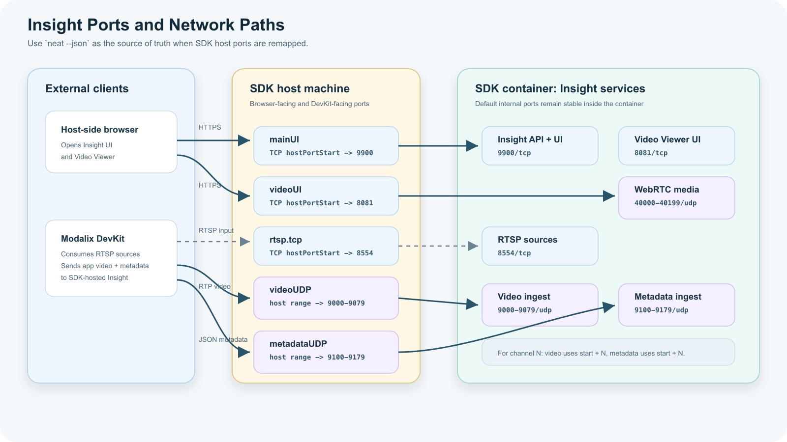

# 埠口和網路行為

Insight 在正常運作期間會使用多個埠。預設埠是 SDK 容器內部或直接安裝的 DevKit 中使用的埠。在 Neat 開發環境中，SDK 會將這些服務發佈到主機埠。如果預設主機埠已經在使用中，`sima-cli` 可以分配另一個可用的主機埠。



| 埠對應名稱 | 預設的連接埠或範圍 | 協定 | 目的 |
| --- | --- | --- | --- |
| `mainUI` | `9900` | HTTPS/TCP | 主要 Insight 網頁使用者介面、HTTP API 以及 HTTP MJPEG 串流來源。 |
| `videoUI` | `8081` | HTTPS/TCP | WebRTC 視訊檢視器使用者介面。 |
| `rtsp.tcp` | `8554` | RTSP/TCP | 從上傳的媒體建立的 RTSP 串流來源。 |
| `videoUDP` | `9000-9079` | UDP | 將影片導入至觀眾頻道 `0-79`，以供 RTP 播放。 |
| `metadataUDP` | `9100-9179` | UDP | 中繼資料 JSON 用於觀眾頻道 `0-79`. |
| `webRTC` | `40000-40199` | UDP | WebRTC 媒體和中繼資料 DataChannel 從虛擬顯示器傳輸到瀏覽器。 |
| `webrtcWhip` | `8889` | HTTPS/TCP | 透過 WHIP 將瀏覽器網路攝影機發布至 MediaMTX，再發布為 RTSP 來源。 |
| `webrtcWhipIce` | `8189` | UDP | 瀏覽器網路攝影機發布所用的 ICE 媒體。訊號傳遞使用 `webrtcWhip`；影片本身在此接收，因此兩者都必須可連線。 |
| `webSSH` | `8022` | HTTPS/TCP | 如果有的話，將瀏覽器外殼與配對的 DevKit 連接。 |

Insight 也會在 `127.0.0.1:9901`（TCP）上執行 mediamtx 控制 API。此 API 僅限迴路介面存取，以每次啟動時產生的密碼保護，且只供 Insight 本身確認網路攝影機來源、偵測外部發布端及設定拉取的串流使用，因此不需要連接埠對應。與其他 mediamtx 連接埠相同，若該連接埠被其他處理程序佔用，會在啟動時將其釋放。

## 找到實際的 SDK 連接埠對應表。

在 SDK 中，請勿假設預設主機連接埠可用。請執行：

```bash
neat --json
```

輸出內容包含 `insight.webUiUrl` 以及一個 `exposedPorts` 陣列：

```json
{
  "exposedPorts": [
    {"hostPortEnd": null, "hostPortStart": 9900, "name": "mainUI", "protocol": "tcp"},
    {"hostPortEnd": 9179, "hostPortStart": 9100, "name": "metadataUDP", "protocol": "udp"},
    {"hostPortEnd": null, "hostPortStart": 8554, "name": "rtsp.tcp", "protocol": "tcp"},
    {"hostPortEnd": 9079, "hostPortStart": 9000, "name": "videoUDP", "protocol": "udp"},
    {"hostPortEnd": null, "hostPortStart": 8081, "name": "videoUI", "protocol": "tcp"},
    {"hostPortEnd": 40199, "hostPortStart": 40000, "name": "webRTC", "protocol": "udp"},
    {"hostPortEnd": null, "hostPortStart": 8889, "name": "webrtcWhip", "protocol": "tcp"},
    {"hostPortEnd": null, "hostPortStart": 8189, "name": "webrtcWhipIce", "protocol": "udp"},
    {"hostPortEnd": null, "hostPortStart": 8022, "name": "webSSH", "protocol": "tcp"}
  ],
  "insight": {
    "serviceState": "Running",
    "venv": "/opt/neat-insight/venv",
    "webUiUrl": "https://10.0.0.210:9900"
  }
}
```

如果主機連接埠已重新映射，則 `hostPortStart` 值就是外部用戶端應使用的連接埠。`hostPortEnd` 則用於指定連接埠範圍，例如視訊、中繼資料和 WebRTC。

## 頻道對應

視訊檢視器使用配對的視訊和中繼資料連接埠。對於頻道 `N`：

```text
video:    UDP 9000 + N
metadata: UDP 9100 + N
```

例如：

| 觀看頻道 | 視訊埠 | 中繼資料埠 |
| --- | --- | --- |
| `0` | `9000` | `9100` |
| `1` | `9001` | `9101` |
| `2` | `9002` | `9102` |

請確保影片和中繼資料的頻道編號一致。如果您的應用程式將影片傳送到頻道 `3`，則請將對應的中繼資料傳送到頻道 `3` 的中繼資料端口。

影片連接埠接受 RTP H.264（酬載類型 `96`）、H.265（`98`）或 JPEG（`26`，即 GStreamer `rtpjpegpay` 所傳送的 RFC 2435 格式）。每個 RTP 封包請保持在 4096 位元組以內；若是 JPEG，請將 `rtpjpegpay mtu=` 設為 4096 或更小。JPEG 影格會透過與中繼資料相同的 WebRTC 連線送達瀏覽器，因此不需要額外的連接埠。

## SDK 埠對應

在 Neat 開發環境中，SDK 容器可能會重新映射端口。Insight 會在可用時讀取 SDK 端口映射配置，以便 UI 連結指向瀏覽器可存取的宿主端口。

這對於影片檢視器來說至關重要。內部預設檢視器端口為 `8081`，但當 SDK 將 `videoUI` 映射到另一個宿主端口時，面向瀏覽器的端口可能會有所不同。

使用 Insight UI 中的系統資訊來檢查實際暴露的端口，然後再假設 URL 錯誤。

## 選用的瀏覽器端設定

託管環境可以將已配對 DevKit 使用的位址，與向外部瀏覽器公告的位址分開。Insight 會讀取兩個僅在啟動時套用的選用檔案：

| 檔案 | 用途 |
| --- | --- |
| `/home/docker/.insight-config/browser-ice-address` | 由 vf 檢視器與 MediaMTX WHIP 端點共同公告、瀏覽器可連線的一個 IPv4 位址。 |
| `/home/docker/.insight-config/launch-url` | 一個受信任的絕對 HTTP 或 HTTPS 啟動 URL。Insight 會使用其來源產生檢視器、WHIP 與 HTTP MJPEG URL。 |

若沒有 `browser-ice-address`，Insight 會保留既有的 `CONTAINER_HOST_IP` 行為。若沒有 `launch-url`，產生的瀏覽器 URL 會繼續使用請求主機與 SDK 連接埠對應。因此，這兩個檔案會各自啟用託管環境行為，不會改變一般的本機或 DevKit 安裝。

`browser-ice-address` 會在 vf 或 MediaMTX 啟動前驗證。空白或格式錯誤的瀏覽器位址會使 Insight 無法進入就緒狀態，而不是默默公告無法連線的位址。`launch-url` 是建議性設定：Insight 接受包含路徑、查詢或片段，且具有 ASCII 主機名稱的完整 URL，但只使用其 HTTP(S) 來源。無效的啟動 URL 會記錄警告，並保留舊有的請求主機與連接埠對應 URL 產生方式。請以不可分割的方式取代檔案、執行 `insight-admin restart`，再檢查 `/api/health`，確認新程序套用了該位址與公開來源。

瀏覽器 ICE 位址不需要指派給本機網路介面。公有雲 IPv4 位址通常透過 1:1 NAT 到達主機。WebRTC 與 `webrtcWhipIce` UDP 連接埠仍必須公開，並由周邊網路原則允許。

## 使用連接埠對應表來設定應用程式。

使用應用程式的位置來決定是否使用預設的容器連接埠，或使用 SDK 主機公開的連接埠。

| 應用程式位置 | 來自 Insight 的 RTSP 輸入。 | 將影片/中繼資料輸出至 Insight。 |
| --- | --- | --- |
| 在 SDK 容器內部 | `rtsp://127.0.0.1:8554/srcN` | `127.0.0.1:9000 + channel` 和 `127.0.0.1:9100 + channel` |
| 在 DevKit 或其他外部機器上 | `rtsp://<sdk-host-ip>:<rtsp.tcp hostPortStart>/srcN` | `<sdk-host-ip>:<videoUDP hostPortStart + channel>` 和 `<sdk-host-ip>:<metadataUDP hostPortStart + channel>` |

HTTP MJPEG 來源使用主要 Insight UI/API 連接埠。在 SDK 中，對於這些 URL，請使用來自 `neat --json` 的 `mainUI` 主機連接埠。

例如，如果 `neat --json` 報告：

```json
{"name": "rtsp.tcp", "hostPortStart": 18554, "protocol": "tcp"}
{"name": "videoUDP", "hostPortStart": 19000, "hostPortEnd": 19079, "protocol": "udp"}
{"name": "metadataUDP", "hostPortStart": 19100, "hostPortEnd": 19179, "protocol": "udp"}
```

接著，在 DevKit 上的應用程式應使用：

```text
RTSP source src1:   rtsp://<sdk-host-ip>:18554/src1
video channel 0:    <sdk-host-ip>:19000
metadata channel 0: <sdk-host-ip>:19100
video channel 3:    <sdk-host-ip>:19003
metadata channel 3: <sdk-host-ip>:19103
```

如果應用程式和 Insight 在同一個 SDK 容器中執行，請改用預設的本機連接埠。

### SDK 直接連線與共用 Proxy

`/home/docker/.insight-config/url-routing` 可明確選擇 URL 路由方式。請以單行寫入 `direct` 或 `proxy`，變更後重新啟動 Insight。空白或無效的值會導致啟動失敗。若檔案不存在，則使用 `proxy`，以維持既有託管環境的行為。

在 `proxy` 模式下，無論連接埠號碼為何，`launch-url` 都會提供檢視器、WHIP 及 HTTP MJPEG URL 的共用來源。Proxy 必須將各路徑轉送至對應服務。在 `direct` 模式下，SDK 啟動功能仍可使用 `launch-url`，但 Insight 不會將其當作公開來源。產生的 URL 會使用請求的主機名稱與各服務設定的連接埠；檢視器使用 SDK 連接埠對應中的 `videoUI`，未設定時則使用 `8081`。瀏覽器 ICE 位址設定與此設定互相獨立。

若本機 SDK 覆寫了啟動 URL，例如 `https://127.0.0.1:9900/`，請將 `url-routing` 設為 `direct`。若不需要覆寫啟動 URL，也可移除 `launch-url`。執行 `insight-admin restart` 後，檢查 `/api/health`：直接路由會顯示 `network.public_origin: null`。即使 Proxy 的連接埠剛好與 SDK 的 `mainUI` 相同，Proxy 來源也不會被改寫。

## 相關工具

- **Neat 開發環境** 提供容器化的建置和執行環境，其中包含 Insight。
- **Neat 函式庫**提供應用程式介面 (API)，用於建立和執行視覺處理工作負載。
- **sima-cli** 會安裝和升級 Insight 套件以及其他 Neat 相關檔案。
- **模型編譯器和 LLiMa** 會產生模型成品，您可以透過工作區來檢視這些成品，並透過與 Insight 一起運行的應用程式來驗證。
