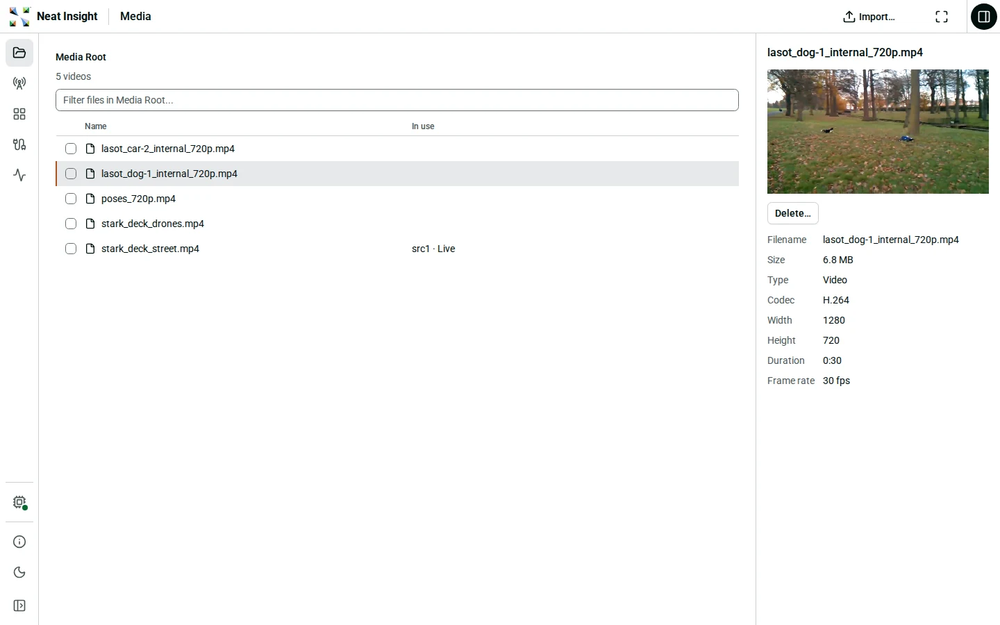
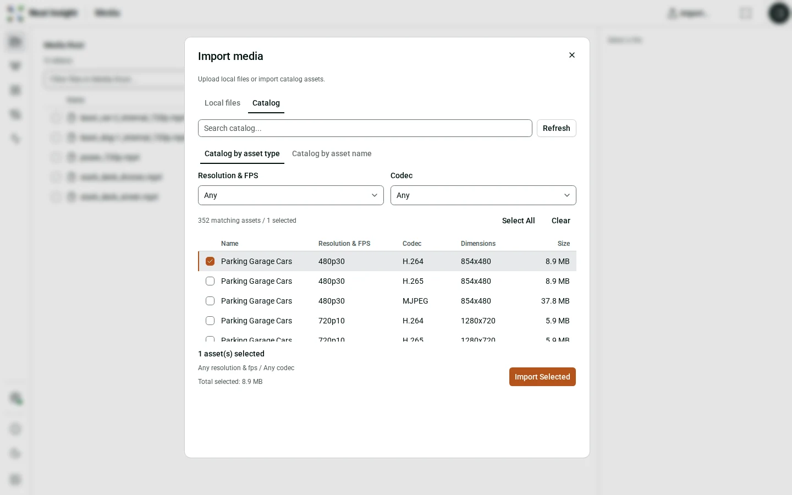
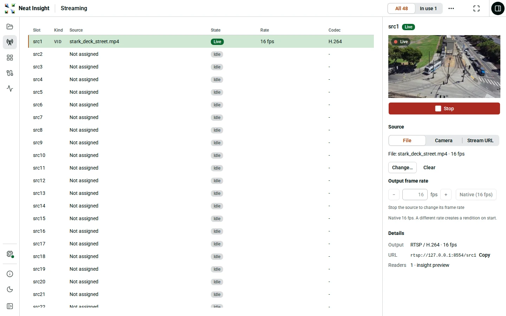
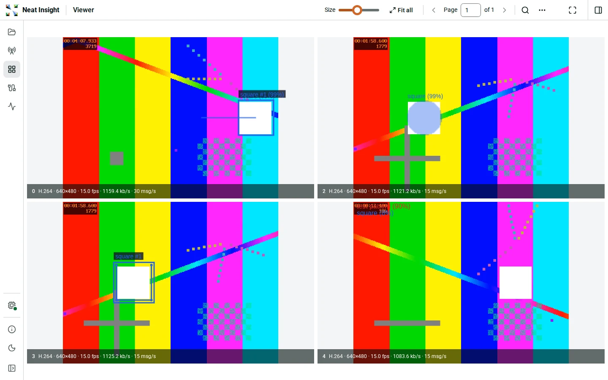
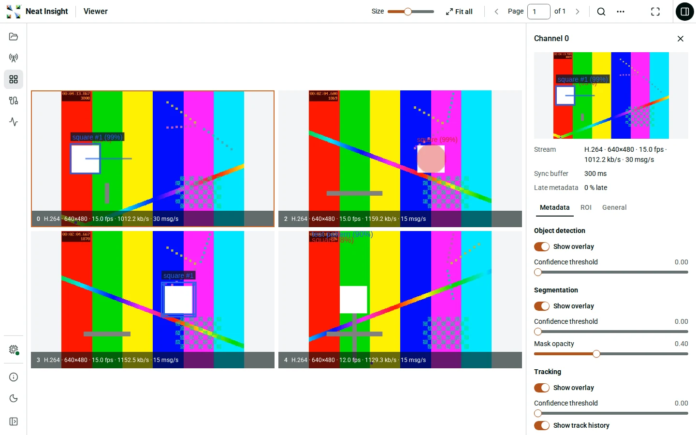
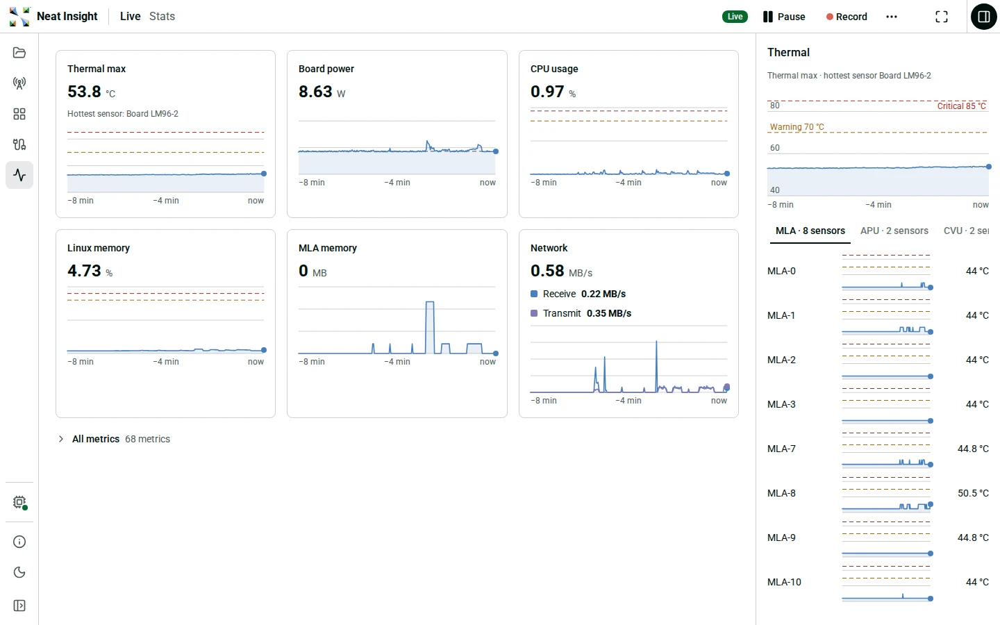
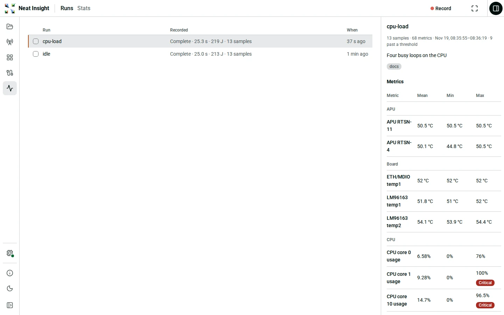
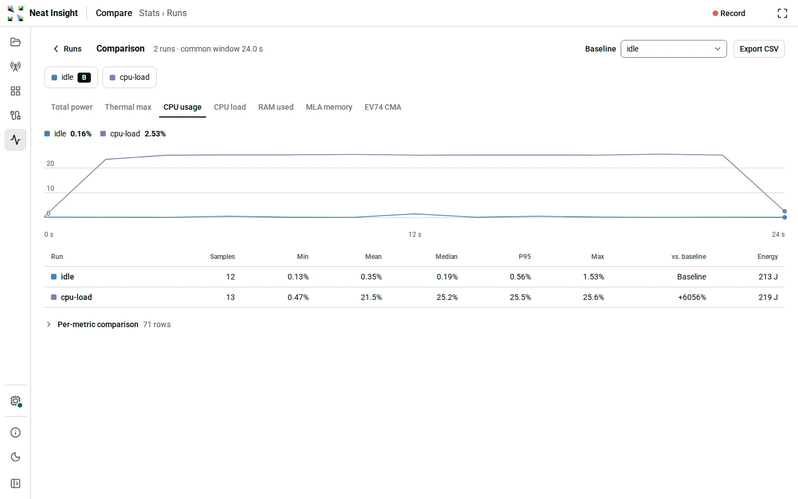
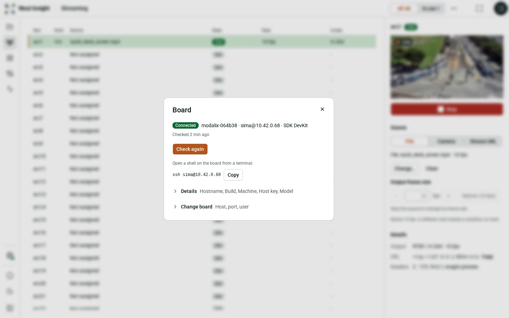
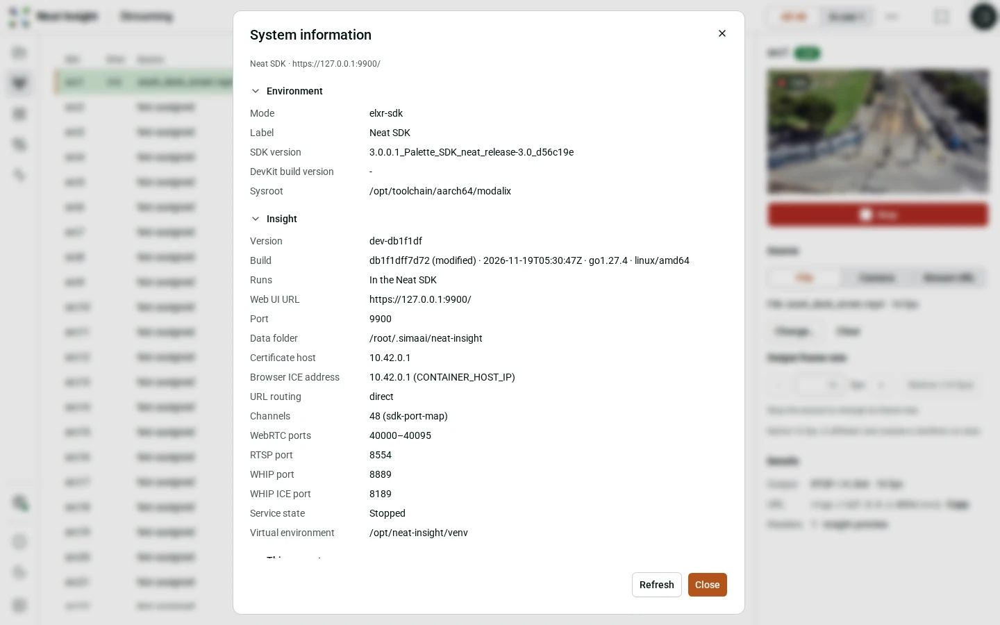

# User Interface

## The rail and the top bar

The **rail** on the left lists the pages: **Media**, **Streaming**, **Viewer**, **Peripherals** and
**Stats**. At its bottom are the selected board (see [The board](#the-board)), **System
information**, the theme, and **Collapse** or **Show labels**.

The **top bar** belongs to the page you are on: its title, then the page's own tools at the right,
**Kiosk mode** (the page without the rail and the bar) and the **Side panel** toggle. Most pages
show what you select in their side panel. On a wide screen you can drag the panel's edge to resize
it, and double-click the edge to reset it; Insight remembers each page's panel in this browser. On
a phone the panel opens over the page.

## Media

Media is the library of video files that sources play. **Import…** opens **Import media**:

- **Local files**: choose or drop MP4, MOV, AVI, MKV or WebM files with H.264, H.265 or MJPEG
  video, or a `.zip` or `.tar.gz` of them. MP4 uploads are normalized for low-latency playback.
- **Catalog**: SiMa's test videos, by asset type (filtered by resolution, frame rate and codec) or
  by name with each one's variants. Importing needs network access.

The library is a folder tree with a breadcrumb and a filter that searches the current folder and
everything beneath it. The **In use** column names the slots that play a file. Files Insight cannot
stream stay listed, grayed out, so you can still look at or delete them.

Select a file to see it in the side panel: a preview, its codec, size, resolution, duration and
frame rate, and **Delete…**. Tick files to delete several at once; the ticks take a file manager's
gestures (Ctrl-click or Cmd-click, Shift-click, Ctrl+A or Cmd+A), here and in Stats' runs.

## Streaming

Streaming lists the 48 source slots, `src1` to `src48`, with each one's kind, source, state, frame
rate and codec. The toolbar shows **All 48** or only the slots **In use**. The **More actions** (⋯)
menu acts on all slots: **Auto assign** (a different file for each slot), **Start…** (how many to
start), **Stop all**, **Reset**, and **Clear renditions**.

A slot's state is **Idle**, **Starting…**, **Encoding**, **Live**, **Failed** or **External** (a
program outside Insight publishes into it); a pulled camera is **Connecting…**, **Live**,
**Unreachable** or **Auth failed**. A codec Neat cannot decode is marked with a warning.

Select a slot to open its side panel: a preview, **Start** or **Stop**, the **Source** it plays, its
output frame rate, and its details with the URL to **Copy**. The **Source** is one of:

- **File**: **Change…** picks a file from the library, **Clear** removes it.
- **Camera**: a webcam on the computer running your browser. **Enable camera access**, then pick a
  camera in the list; the browser publishes it while the tab stays open.
- **Stream URL**: an RTSP or RTSPS camera Insight pulls, with its username and password. Insight
  keeps the password in memory only.

A file plays at its own frame rate unless you set another one: on **Start**, Insight then encodes a
copy at that rate (a rendition) once and reuses it. MJPEG files keep their own rate.

A slot that another program publishes into is **External**. **Take over…** disconnects that
program. See [Common workflows](workflows.md) for webcams, IP cameras and external publishers.

## Viewer

The Viewer shows the channels your apps send, as a grid of tiles, with their metadata drawn over
the video. The toolbar sets the tile **Size**, fits all tiles or a number of them on a page
(**Fit all**, **Fit N**), turns pages, and **Go to channel** jumps to one (`/`). The ⋯ menu shows or
hides each tile's bar, and can hide channels without video.

Select a tile to show that channel in the side panel; with no tile selected, the panel's settings
apply to **All channels**. A setting you change on one channel overrides the global value there
and can be reset. The panel's tabs:

- **Metadata**: for each type (object detection, segmentation, tracking, pose, classification),
  whether its overlay shows, its confidence threshold, and its own options, such as the mask
  opacity or the track trails.
- **ROI**: regions of interest you draw on a channel, to show and to filter detections by. They
  stay in this browser.
- **General**: the **Video sync buffer** (how long the video is held back so metadata can catch up,
  300 ms by default), **Metadata retention** and **Line width**.

When much of a channel's metadata arrives after its frame was shown, the tile shows **Metadata
late**. Select it to raise the video sync buffer for that channel or for all of them.

The settings are kept in this browser. The Viewer's address takes options
([Contracts, Viewing](contracts.md#viewing)), so a link can open it on given channels.

## Peripherals

Peripherals lists the cameras and microphones of the selected board, as Sentinel on the board
reports them. Insight scans the board when you open the page; **Refresh** scans again. Scanning
never opens a device, so your apps keep them.

- **A camera** shows its pixel formats and resolutions, each **Available** to Neat's camera input
  or **Unsupported** with the reason. For a USB camera, Available means Sentinel reports the mode
  in MJPEG on the `uvcvideo` driver, which Neat's USB camera input reads; a Sentinel too old to
  check USB cameras leaves every USB mode Unsupported and says to update it. **Start preview**
  shows what the camera sees, at a low frame rate. While it runs, the preview holds the camera,
  and your app cannot open it; leaving the page stops it. A USB camera without a `/dev/v4l/by-id`
  link is opened by its `/dev/videoN` node, so Insight first asks Sentinel to rescan and asks you
  to **Refresh** when that node is no longer the same camera. **Camera ID**, on the camera's
  title row, shows the ID a Neat application opens the camera by (`CameraInput` for MIPI,
  `UsbCameraInput` for USB) with a **Copy** button.
- **A microphone** shows what it captures. **Test microphone** records with a level meter, then
  plays the recording back.

## Stats

Stats shows the selected board's telemetry from Sentinel. Its views are **Live** and **Runs** in
the rail, and **Compare**, opened from Runs; each has its own address to bookmark or share. If
Sentinel is missing or stopped, the page shows the command that installs or starts it, to run on
the board.

- **Live** shows cards for the hottest temperature, board power, CPU and memory use, accelerator
  memory (MLA and EV74 stacked, which Sentinel counts once each, so the top edge is their sum) and
  network traffic, and **All metrics** below them. Select a card for its area (**Thermal**, **Power**,
  **System**, **Storage & Network**) in the side panel. **Pause** stops the updates, and **Export
  CSV** in the ⋯ menu saves the samples Sentinel holds.
  Board power and energy are labeled **Estimated**: they are the sum of the SoM's regulator rail
  readings, which has not been calibrated against the SoM's input power.
- **Record**, on every view, records a trace on the board until you **Stop** it; the trace is saved
  as a run.
- **Runs** lists the saved runs. Select one for its metrics in the side panel. Tick two to eight
  for **Compare**, or **Delete** them.
- **Compare** overlays one series of the runs (total power, temperature, CPU, memory) against a
  **Baseline** run, with a summary per run, a **Per-metric comparison** table and **Export CSV**.

## The board

The board block at the bottom of the rail names the selected board and whether Insight reaches it,
with a dot in the state's color. Select it to open **Board**: the board's details, **Check again**,
the `ssh` command to open a shell on it, and **Change board**, where you enter a board's address,
SSH port and user, or go back to the default.

Without a board you entered, Insight uses the board it runs on, or in the SDK the DevKit paired
with `sima-cli sdk setup --devkit <ip>`. It connects with the SSH keys of the account that runs it
and never asks for a password. When the board refuses the key, Insight shows the `ssh-copy-id`
command that authorizes it; when a reflashed board presents a new host key, Insight asks you to
compare and trust it.

## System information

**System information** in the rail shows Insight's version and settings (its address, ports,
data folder, certificate and channel count), the computer Insight runs on (CPU, memory, disk), and
in the SDK the installed components, available updates and the ports the SDK publishes. It is the
first place to look when a port or an address is not what you expect.
